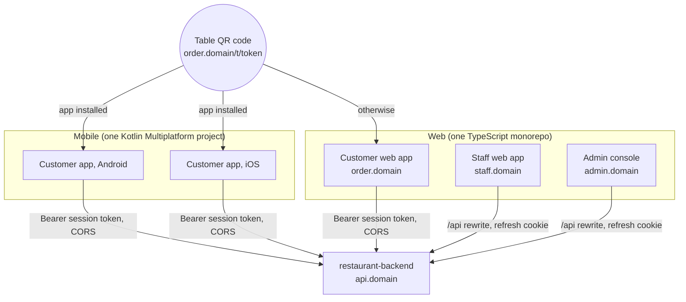

# Building the system from scratch: backend, web and mobile

| Version | Date | Audience | Status |
|---|---|---|---|
| 1.0 | 2026-10-19 | The owner and anyone building the client apps, or rebuilding the backend elsewhere | A guide and a proposal. The backend parts describe what exists; the web and mobile parts are recommendations that need the owner's decisions (§2) before they become a project |

The approved scope of this project is the **backend only**; the apps are separate projects (requirements §1). This guide covers the whole system a restaurant would actually use:



| Part | What it is | Where it stands |
|---|---|---|
| 1. Backend | Ktor service, this repository | Built, released (`1.0.1`), test data only |
| 2. Customer web app | Browser ordering for guests, and the landing page every QR code opens | Not started |
| 3. Staff web app | Waiters, kitchen and managers, on tablets and phones; also the invitation and reset pages | Not started |
| 4. Admin console | Platform admins | Not started |
| 5. Customer mobile app | Android and iOS, opened by the same QR codes | Not started |

Contents: [1 Recommended order](#1-recommended-order) · [2 Decisions first](#2-decisions-to-make-first) · [3 Backend from scratch](#3-the-backend-from-scratch) · [4 Rules every client follows](#4-rules-every-client-follows) · [5 Web apps](#5-the-web-apps) · [6 Mobile app](#6-the-customer-mobile-app) · [7 Backend changes when clients arrive](#7-backend-changes-when-the-clients-arrive) · [8 Testing the whole system](#8-testing-the-whole-system)

## 1. Recommended order
| Step | Build | Why this order | Done when |
|---|---|---|---|
| 0 | Decisions (§2) and two small spikes: the staff app's `/api` rewrite with the refresh cookie on Vercel, and the deep links | Vercel's edge has surprised this project before (D-1); prove the two risky mechanisms before building on them | Both spikes pass; decisions recorded in STATUS |
| 1 | Shared web packages: API types, API client, i18n, UI kit (§5.2) | All three web apps use them | Types generated from the contract; client handles the §4 rules, with tests |
| 2 | Staff web app (§5.4) | Without it nobody can accept an invitation or run a restaurant; with it a restaurant can already work, because waiters can order for guests (FR-014) | AT scenarios for staff pass through the app |
| 3 | Admin console (§5.5) | Onboarding (FR-040) without the API by hand; small | A restaurant onboarded and suspended through the console |
| 4 | Customer web app (§5.3) | Every QR code lands here; it's the fallback for every phone | A guest orders from a scanned code |
| 5 | Customer mobile app (§6) | Store review and a 12-month support window for every version make it the costliest to change, so it comes when the API use is proven by the web app | Published to internal testing on both stores; AT-031 (the camera hands off to the app) passes |
| 6 | Whole-system acceptance (§8) | Every AT so far ran through the API only | Every Must AT passes through the apps |

## 2. Decisions to make first
Each is the owner's, and each goes into the STATUS Decisions table when made. Some reopen earlier decisions, so they may need a CR.

| # | Decision | Why it's needed | Suggestion |
|---|---|---|---|
| D-A | **A public API address.** A browser or phone can't send the bypass header | Real clients can't reach the API otherwise | **Production decided (Q-29):** `restaurant-production.vercel.app` stays public. Later, a custom domain per environment (`api.<domain>`, `api.staging.<domain>`) attached to the Vercel project, with Deployment Protection's scope set so that domain is public |
| D-B | **Domains** for the three web apps, on the same registrable domain as the API | The refresh cookie is `SameSite=Strict`, and App Links / Universal Links need a stable host | `order.<domain>`, `staff.<domain>`, `admin.<domain>`, `api.<domain>` |
| D-C | **Client technology** | Architecture §4 leaves it to the client side; a shared contract module with the backend would need a new ADR | Web: React + TypeScript (§5.1). Mobile: Kotlin Multiplatform with Compose Multiplatform (§6.1). No module shared with the backend: the contract is the shared thing |
| D-D | **Repositories** | One per client, as requirements §1 says | `restaurant-web` (monorepo, three apps) and `restaurant-mobile` |
| D-E | **Live push or polling** | Release 1 polls (CR-013); a client written to the full rules works either way | Build the full rules from the start (§4.6): with `LIVE_PUSH=off` the token call's `503` keeps the app polling |
| D-F | **Store accounts** | Google Play developer account and Apple Developer Program (paid) | Needed before step 5. Outside the free-plan rule: the owner decides when |
| D-G | **Menu photos** (FR-022, TBD-13) | The staff app's item editor either has an upload or doesn't | Leave it out until TBD-13 is decided; design the editor with a place for it |

## 3. The backend from scratch
This repository is the backend. This section is for rebuilding it (on another platform, or as a template for a similar service), and for knowing how it was put together.

### 3.1 Run the existing one
```
git clone https://github.com/phongmanh/restaurant-backend.git
cd restaurant-backend
./gradlew build          # ktlint, detekt, tests, Kover, route matrix; Gradle fetches JDK 25 if needed
```
Docker must be running (Testcontainers starts PostgreSQL 18). To run it locally: a PostgreSQL 18 database, secrets from `./gradlew generateSecrets --args="<file> --db-host localhost --db-name restaurant"`, `./gradlew migrate` with that file exported, then `./gradlew run` with `APP_ENV=dev` and the same variables; it listens on port 8080. In `dev` the service counts rate limits in memory and needs neither Upstash nor the OTLP settings.

### 3.2 The process that built it
The service was built as a phased SDLC with six owner-decided gates, and every phase left a document behind:

| Phase | Output | Gate |
|---|---|---|
| 1 Requirements | requirements.md: FRs with Given/When/Then criteria, NFRs with numbers, data inventory, compliance | G1 |
| 2 Architecture | architecture.md, ADRs, threat model, capacity model, five spikes that measured the risky parts (cold start, database through the pooler, pub/sub, sign-in cost, reports) | G2 |
| 3 Design | Seven feature designs and the OpenAPI contract, frozen | G3 |
| 4 Build | The code, in nine steps of one PR each, plus hardening | G4 |
| 5 Test | System, load, security (ZAP, ASVS), restore drill on staging | G5 |
| 6 Release | Production, rollback rehearsal, watch period | G6 |

The lesson worth copying: **spikes before the architecture is signed off.** S-1 to S-5 turned guesses (cold starts, pooler behaviour, Argon2id cost, report speed) into measured numbers, and the Q-19 spike explained D-1 before a fix was chosen.

### 3.3 The build order
Each step is one PR with its tests; the build stays green at every step.

| Step | Adds | Key content | Tests that prove it |
|---|---|---|---|
| 1 Skeleton | Gradle build, Ktor app, CI | Version catalogue pinned at the start; ktlint, detekt, Kover; `/health`; JSON logs; the `Endpoints` registry | CI green on an empty service |
| 2 Core | Transactions, RLS, idempotency, `If-Match`, audit, problem+json | `Transactor` (tenant, platform, global), forced RLS with one `tenant_isolation` policy, `idempotency_keys`, hash-chained `audit_events`, `DomainError` → problem+json; Exposed retries off | RLS test over every table; idempotency replay/conflict; log privacy |
| 3 Auth | Staff and admin sign-in | Argon2id (Bouncy Castle), ES256 tokens, rotating refresh tokens, TOTP, lockout, invitation and reset links; `endpoint()` authenticating by path group | Timing-even failures; token cases; reuse revokes the family |
| 4 Restaurants | Tenants, staff, admins, audit read, privacy | Onboarding with idempotency and fresh links on replay; last-manager rule with an advisory lock; suspension flag on every registry entry | Role and other-restaurant cases per route |
| 5 Menu | Categories, items, options, sold out | `menu_state` lock row first; menu `ETag` = version; `MenuCatalog` port | Concurrency: two creates at the last free slot |
| 6 Tables | Tables, QR codes, sessions, waiter calls, first job | Signed QR tokens; one open session per table (partial unique index, `ON CONFLICT DO NOTHING`); `SessionAccess` port; `job()` with the cron secret | Concurrent first scans; concurrent moves |
| 7 Orders | Orders, bills, payments, corrections, retention job | Server pricing with snapshots; the lock order; close with `If-Match` + `Idempotency-Key`; `SalesLedger` writes | Cancel vs accept; order vs close; six closes at once |
| 8 Realtime | Event log, catch-up, outbox, Ably | Per-restaurant `seq` taken late in the transaction; snapshots in catch-up answers; publish in `afterCommit` | Cursor never skips; after-commit failure doesn't fail the request |
| 9 Reports | Daily aggregates, report, nightly rebuild | Four aggregate tables; rebuild per restaurant-day | Report across time zones; rebuild repairs a missed update |

Then hardening (route-test matrix, contract check on every response, statuses documented, the security review) and, in Phase 5, metrics over OTLP, alerts as code and the system suite.

### 3.4 Carrying it to another platform
If the backend ever moves off Vercel (CR-001, deferred: cold starts of 5–7 s on the free plan), most of it carries over unchanged, because the service already assumes nothing about instances. What changes:

| Vercel-specific part | Elsewhere |
|---|---|
| `Dockerfile.vercel`, `vercel.json` (region, rewrites, crons) | A normal container image; a scheduler calling the same `/internal/jobs/*` routes with the cron secret |
| WAF rule `auth-per-ip` | The platform's rate limiting or a reverse proxy |
| `POST …/update` instead of `PATCH` (D-1) | Keep it: clients already use it, and `/v1` changes only additively |
| Push-based metrics (no scraping) | Still works; scraping becomes possible |
| Deployment Protection and the bypass header | Network rules or an identity-aware proxy |
| Hobby's once-a-day cron | The designed schedules (core-and-auth §10) |

## 4. Rules every client follows
These come from the contract and the designs. A client that breaks one of them works in a demo and fails in production. Each web and mobile API layer implements them once, centrally, with tests.

### 4.1 Wire format
- **JSON fields are `snake_case`.** Ignore unknown fields in responses; never fail on them.
- **Enums: accept values you don't know** and show a neutral state ("in progress" for an unknown order status). New values such as FR-016's `pending_confirmation` arrive without a new API version.
- **Money is a string of whole đồng**: `{"amount": "125000", "currency": "VND"}`. Never parse it into a floating-point number; use `BigInt` (TypeScript) or `Long` (Kotlin). Display with the locale's grouping (`125.000 ₫` in `vi`).
- **Times are UTC** (`2026-10-15T09:30:00.123Z`). Show them in the restaurant's time zone (from the profile), not the device's.
- **IDs are opaque strings.** Don't parse UUIDs for meaning.
- **Lists** page with `next_cursor`; stop when it's absent.

### 4.2 Headers on every request
| Header | Value |
|---|---|
| `X-Client` | `<app>/<semver>`: `customer-android/1.2.0`, `customer-ios/1.2.0`, `customer-web/…`, `staff-web/…`, `admin-web/…` |
| `Content-Type` | `application/json` on every body |
| `Authorization` | `Bearer <token>` (guest session token, or staff/admin access token) |
| `Idempotency-Key` | On the operations that need it (§4.3) |
| `If-Match` | On updates and deletes of versioned resources (§4.4) |

Read `X-Request-ID` from every response and show it with any unexpected error, so support can find the log line.

### 4.3 Retries and `Idempotency-Key`
Required on: placing an order (guest and staff), closing a session, onboarding a restaurant.
- **Create the key when the person taps** (a UUID), keep it with the pending action, and **reuse it on every retry** of that action. A new action gets a new key.
- A replay returns the original answer (`Idempotent-Replayed` header). `422 idempotency_key_reused` means the body changed under the same key: a client bug. `409 idempotency_request_in_progress`: retry shortly.
- Retry only on network failures, `429`, `503` and `500`, with backoff, honouring `Retry-After`. Never retry a `4xx` other than `429`.
- Other operations are safe to repeat by design (opening a session, waiter calls, sold out, acknowledge, cancel) and take no key.

### 4.4 Concurrent edits: `ETag` and `If-Match`
- Keep the `ETag` from the read (or the previous write) of a versioned resource, and send it as `If-Match` on its update, delete, status change, move or close.
- `412 precondition_failed`: someone changed it. Re-read, show the new state, let the person decide. Never retry blindly.
- `428 precondition_required`: the client forgot `If-Match`: a bug.
- **Updates are `POST <path>/update`**, never `PATCH` (Vercel's edge breaks `PATCH` with `If-Match`; the `PATCH` operations are deprecated).

### 4.5 Errors
`application/problem+json` with `code`, `title`, `status`, `request_id`, and for `400` an `errors` list (`{"field": "/lines/2/option_ids", "code": "option_required"}`, a JSON Pointer to the field). Map `code` to localised text (vi, en); fall back to a generic message for an unknown code. Some problems carry data: `unavailable_items` (`item_unavailable`), `order_ids` (`orders_not_finished`). The user-facing meaning of each is in [user-guides.md §7](user-guides.md#7-what-the-messages-mean).

Status handling: `401` → sign in again (staff) or "visit ended" (guest `table_session_closed`); `403` → hide or disable the action; `404` → "not found" (it may belong to someone else, the API won't say); `426 client_upgrade_required` → force an update screen; `429` and `503` → wait `Retry-After`.

### 4.6 Keeping screens current
The event log is the source of truth. Release 1 polls; a client written to the full design keeps working when live push is switched on.

**Start a screen:**
1. `GET …/events` without `after` → keep `cursor`.
2. Load the screen's state (orders and bill; or the kitchen list, the floor view).
3. (Live push) `POST …/realtime-token`; a `503` means polling only, as in release 1. Otherwise subscribe with the Ably SDK.
4. `GET …/events?after=<cursor>` once, to cover the gap.

**Then:**
- **Poll** `GET …/events?after=<cursor>` every **15 s (staff) or 60 s (guests)**, each wait randomised by ±20 %, so screens don't poll in step.
- **Catch up at once** after the screen's own write, and when the app returns to the foreground or the tab becomes visible.
- Apply each snapshot only if its `version` is higher than the one held. Move `cursor` even past event types you don't know.
- On `reset: true`, reload the screen's state. On `has_more: true`, read the next page at once.
- On a guest `401 table_session_closed`, stop polling: the visit has ended.
- Pause polling while the app is in the background (mobile) or the tab is hidden (web), then catch up on return.

A sketch of the loop, the same in both languages:
```kotlin
suspend fun follow(screen: Screen, period: Duration) {
    var cursor = api.events(after = null).cursor
    screen.reload()
    while (screen.isActive) {
        val page = api.events(after = cursor)
        if (page.reset) screen.reload() else screen.apply(page.orders, page.waiterCalls, page.events)
        cursor = page.cursor
        if (!page.hasMore) wake.awaitAny(timeout = period * Random.nextDouble(0.8, 1.2))
    }
}
// wake fires on the screen's own write and on returning to the foreground.
```

### 4.7 Security on the device
- Never log tokens, links or personal data; strip them from crash reports.
- Invitation and reset tokens arrive in the URL **fragment** (`#…`), which browsers don't send to servers. Read it, then remove it from the address bar (`history.replaceState`).
- QR tokens arrive in the path (`/t/<token>`); send them only to `POST /v1/guest/sessions`.
- Don't cache `no-store` responses. The menu is the exception: cache it by `ETag` and revalidate with `If-None-Match` (a `304` is cheap).

## 5. The web apps
### 5.1 Stack
The same stack for all three apps, the well-supported defaults for a TypeScript single-page app (this machine's `react-waterfall` skill uses them too):

| Concern | Choice |
|---|---|
| Language | TypeScript, `strict` |
| Build | Vite |
| UI | React |
| Routing | React Router |
| Server state | TanStack Query (caching, retries, refetch on focus) |
| Validation | Zod for forms |
| Styling | Tailwind CSS |
| API types | `openapi-typescript`, generated from `docs/api/openapi.yaml` |
| i18n | `vi` and `en` message catalogues; error `code` → message |
| QR images | A QR library to draw codes from the `url` the API returns (staff print sheet, admin TOTP enrolment) |
| Lint | oxlint or ESLint, Prettier |
| Tests | Vitest + Testing Library; Playwright for end to end; axe for accessibility |
| Hosting | Vercel (one project per app per environment) |

Pin every version at the project's start in the lockfile, as the backend pinned its catalogue, and let Dependabot propose updates.

### 5.2 Monorepo layout
```
restaurant-web/
  packages/
    api/            # generated types + the client: headers, Idempotency-Key, If-Match,
                    # retries, problem+json, money, the event follower (§4)
    i18n/           # vi/en catalogues, error-code messages, money and time formatting
    ui/             # shared components: buttons, dialogs, money, status badges
  apps/
    customer/       # order.<domain>
    staff/          # staff.<domain>
    admin/          # admin.<domain>
```
`packages/api` is the only code that talks to the API, and its tests cover every rule in §4. Regenerate its types whenever the contract changes; CI fails if the committed types differ from a fresh generation.

### 5.3 Customer web app (`order.<domain>`)
**Screens** (the guest guide, [user-guides.md §6](user-guides.md#6-guest)):

| Route | Screen | API |
|---|---|---|
| `/t/:qrToken` | Join the table: shows the restaurant and table, then the menu | `POST /v1/guest/sessions` |
| `/menu` | Menu by category, language switch, item sheet with options and quantity | `GET /v1/guest/menu?lang=` (+ `If-None-Match`) |
| `/cart` | Lines, notes, send | `POST /v1/guest/orders` |
| `/orders` | Orders with statuses; cancel while `placed` | `GET /v1/guest/orders`, `POST …/{id}/cancel`, events every 60 s |
| `/bill` | Running bill | `GET /v1/guest/bill` |
| (button) | Call waiter / ask for the bill | `POST /v1/guest/waiter-calls` |
| `/ended` | "Visit ended, scan again" | after `401 table_session_closed` |

**Session handling:**
- `device_id`: a random UUID, created once and kept in `sessionStorage`.
- The session token: in memory and `sessionStorage` (one visit, low value), with a strict CSP. It lasts 6 hours; after that, a new scan gets a new token for the same session.
- Calls go straight to `api.<domain>` with the bearer token; the API's CORS allow-list must include `https://order.<domain>`.

**Deep-link files.** This app's domain serves the files that let a phone open the mobile app instead:
- `/.well-known/assetlinks.json` (Android App Links): the app's package name and its signing certificate's SHA-256 fingerprint.
- `/.well-known/apple-app-site-association` (iOS Universal Links), served as `application/json` without a redirect: the app ID and the path `/t/*`.

**Performance:** guest reads target 200 ms at p95; keep the bundle small (the menu route first), show the menu from cache while revalidating, and test on a mid-range Android phone over 4G.

### 5.4 Staff web app (`staff.<domain>`)
**Screens** by role ([user-guides.md §3–5](user-guides.md#3-manager)):

| Area | Screens | Roles |
|---|---|---|
| Account | Sign in, invitation (`/invite#token`), reset (`/reset#token`), change password, sign out | All |
| Kitchen | Order board by status (placed, accepted, preparing, ready), line reject, sold-out toggles | Kitchen, manager |
| Floor | Floor view, table detail with orders and bill, waiter calls, order for a table, move, close with payment, bills of a day | Waiter, manager |
| Menu | Categories (drag to reorder), items with option groups and both languages | Manager (sold out: kitchen too) |
| Tables | Tables, QR print sheet (drawn from `GET /v1/staff/tables/qr-codes`), rotate one or all | Manager |
| Staff | Members, invite (shows the link once, with a copy button), role, deactivate, reset link | Manager |
| Restaurant | Profile, opening hours, languages | Manager (read: all) |
| Reports | Daily sales for a range, with totals and breakdowns; corrections on a closed bill | Manager |
| Audit | Audit log with filters | Manager |

Show only what `GET /v1/auth/me`'s role allows; the server still checks every call.

**Tokens and the cookie** (core-and-auth §8.3):
- The access token (15 min) lives **in memory only**.
- The refresh token is an `HttpOnly; Secure; SameSite=Strict` cookie the page can't read. For the browser to keep it, the app calls the API **through its own origin**: a rewrite `/api/*` → `https://api.<domain>/*` in the app's `vercel.json`. The API then sets the cookie with `Path=/api/v1/auth` (`AUTH_COOKIE_PATH`).
- On load and before the access token expires: `POST /api/v1/auth/refresh` with `{"audience": "staff"}`.
- **Serialise refreshes across tabs.** Two tabs refreshing with the same token look like theft, and the server ends the sign-in. Use the Web Locks API (`navigator.locks.request("refresh-staff", …)`) or a `BroadcastChannel`, and share the new access token between tabs.
- The browser needs no CORS for same-origin calls, but the API does: the rewrite forwards the browser's `Origin` header (sent on every `POST`), so the app's origin goes on the API's `ALLOWED_ORIGINS`, or every write gets a bare `403` (CR-016). The CSP can be strict (`default-src 'self'`).

**Kitchen board ergonomics:** large touch targets; one tap per step (each step is one `POST …/status` with `If-Match`); a sound or flash for a new `OrderPlaced`; keep the screen awake (Screen Wake Lock API); after a `412`, refresh that card only.

**Close dialog:** shows the bill total and its version; a payment method and amount received (≥ total, change shown); a second confirmation listing unfinished orders after `409 orders_not_finished`; the close sends `If-Match` (the bill's `ETag`) and an `Idempotency-Key` created when the dialog opened.

### 5.5 Admin console (`admin.<domain>`)
| Screen | API |
|---|---|
| Sign in, then the 6-digit code | `POST /v1/auth/sign-in` → `mfa_required` → `POST /v1/auth/mfa` |
| Invitation with TOTP enrolment: password, then a QR of `otpauth_uri` (with the `secret` as text), then the first code | `POST /v1/auth/invitations/accept` twice: the second call adds `totp_code` |
| Restaurants: list, onboard (shows the invitation link once), edit, suspend, reactivate | `/v1/admin/restaurants…` |
| A restaurant's members and menu (read) | `/v1/admin/restaurants/{id}/members…`, `/menu` |
| Admins: invite, deactivate, reset password, reset TOTP | `/v1/admin/admins…` |
| Audit log (any restaurant or the platform chain) | `GET /v1/admin/audit-events` |
| Privacy requests: export, erase | `/v1/admin/staff-accounts/{id}/export`, `…/erase` |

The same token handling as the staff app with `{"audience": "admin"}` and its own cookie (`__Secure-rt-admin`). Consider an IP allow-list or Vercel's protection on this app's domain: architecture §12 lists it as an option.

### 5.6 Deploying the web apps
- One Vercel project per app per environment, disconnected from GitHub until the team wants preview builds. Remember the lessons in `CLAUDE.md`: name the project in every command; check aliases after a production deploy.
- Security headers on every app: HSTS, a strict CSP, `X-Content-Type-Options: nosniff`, `Referrer-Policy: no-referrer` (protects link fragments and QR paths), `frame-ancestors 'none'`.
- Build-time settings: the API base (`/api` for staff and admin, `https://api.<domain>` for customer) and the app version for `X-Client`.

## 6. The customer mobile app
### 6.1 Stack
**Kotlin Multiplatform (KMP) with Compose Multiplatform**, one codebase for Android and iOS. Why: the owner works in Kotlin and Android Studio; the backend's own libraries carry over (Ktor client, kotlinx.serialization, Koin); and the guest app is small (11 guest operations), so one UI codebase is enough. If iOS needs a fully native feel later, the shared module stays and only the iOS UI moves to SwiftUI.

| Concern | Choice |
|---|---|
| Shared code | KMP `shared` module: API client, DTOs, the event follower, view models |
| UI | Compose Multiplatform (Android and iOS) |
| HTTP | Ktor client (OkHttp engine on Android, Darwin on iOS) |
| JSON | kotlinx.serialization with `ignoreUnknownKeys = true`, and a small custom serializer per enum that maps unknown values to `Unknown` (kotlinx.serialization fails on an unknown enum value by default) |
| DI | Koin |
| Storage | DataStore (multiplatform) for the device ID and language; the session token in memory, plus encrypted storage (Android Keystore, iOS Keychain) so a restart within the 6-hour visit keeps it |
| Camera | The system camera opens the QR link (App Links / Universal Links); an in-app scanner (CameraX + ML Kit on Android, AVFoundation on iOS) for "Scan your table" |
| Tests | `commonTest` for the API layer and view models (Ktor `MockEngine`); Compose UI tests; an end-to-end flow tool such as Maestro against staging |
| Release | Play Console internal testing, then production; TestFlight, then the App Store |

Pin versions in `gradle/libs.versions.toml` at the start, as the backend did.

### 6.2 Project layout
```
restaurant-mobile/
  shared/
    src/commonMain/kotlin/…/api/        # DTOs for the guest operations, ApiClient, problem mapping
    src/commonMain/kotlin/…/follow/     # the event follower (§4.6)
    src/commonMain/kotlin/…/ui/         # Compose screens and view models
    src/commonTest/                     # API rules, contract check of the DTOs
  androidApp/                           # Activity, manifest (App Links intent filter), icons
  iosApp/                               # Xcode project, Associated Domains entitlement
  gradle/libs.versions.toml
```

**DTOs:** hand-written `@Serializable` classes for the guest operations, with a test that checks each against the contract's schemas. NFR-COMPAT-01 asks for exactly that: contract tests against the oldest supported client's DTOs. Keep the DTOs of every released version's tag, and run the backend's contract check against them in the backend's CI, so a server change that would break an old app fails there.

### 6.3 Screens
The customer web app's screens (§5.3), plus:
- **Home**: "Scan your table" (in-app scanner) and the language.
- **Forced update**: shown on `426 client_upgrade_required`, linking to the store.
- **Offline**: a banner when the network is down; the pending order waits with its `Idempotency-Key` and is sent when the network returns.

### 6.4 Deep links: one QR, two apps
The QR code holds `https://order.<domain>/t/<qrToken>` (tables §2).
- **Android:** an intent filter with `android:autoVerify="true"`, scheme `https`, host `order.<domain>`, `pathPrefix="/t/"`; the customer web app serves `assetlinks.json` (§5.3) with the release key's fingerprint (and Play App Signing's).
- **iOS:** the Associated Domains entitlement `applinks:order.<domain>`; the web app serves `apple-app-site-association` with the path `/t/*`.
- On open, take the token from the path, call `POST /v1/guest/sessions` with the stored `device_id`, and go to the menu. Without the app, the same link opens the web app: AT-031 checks both.

### 6.5 Lifecycle
- Poll every 60 s ±20 % only while the app is in the foreground; on resume, catch up at once (§4.6).
- On `401 table_session_closed`, clear the session and show "Visit ended".
- `X-Client: customer-android/<versionName>` or `customer-ios/<CFBundleShortVersionString>`; the server's `MIN_VERSION_CUSTOMER_ANDROID` / `_IOS` decide when `426` starts.
- **Support window:** every released version must keep working for 12 months (TBD-3). Never depend on behaviour the contract doesn't promise.

## 7. Backend changes when the clients arrive
The backend is ready for clients, but its settings and a few details assume none exist yet.

| Change | Where | Why |
|---|---|---|
| Public API domain per environment | Vercel project domains, Deployment Protection scope (D-A) | Clients can't send the bypass header |
| `STAFF_APP_URL`, `ADMIN_APP_URL`, `CUSTOMER_APP_URL` | `deploy/<env>/<env>.env` | Today `*.production.example`; invitation, reset and QR links point there. Set each from `vercel alias ls` after the app's first deploy, since Vercel may add a suffix to the name (Q-29) |
| `ALLOWED_ORIGINS` | The same files | Every web app's origin: `https://order.<domain>`, and the staff and admin apps' too, since their rewrite forwards the browser's `Origin` (CR-016) |
| `AUTH_COOKIE_PATH=/api/v1/auth` | The same files | The staff and admin apps' rewrite (§5.4); done on production (Q-29), staging still `/v1/auth` |
| `AUTH_ISSUER` | The same files | The API's real public URL |
| Known client names in metrics | `Metrics.client`'s known set (today the keys of `minClientVersions`: `customer-android`, `customer-ios`) | Otherwise `customer-web`, `staff-web` and `admin-web` all count as `other` |
| Contract `servers` | `docs/api/openapi.yaml` (descriptions only, additive) | Today a placeholder |
| Reprint every QR code | Managers, after `CUSTOMER_APP_URL` changes | The code holds the URL; old prints point at the old host |
| The designed jobs not yet built | Technical reference §11 (Q-28) | Before real customers |
| FR-022 image upload | When TBD-13 is decided | The staff app's item editor |

Each change of a committed env file runs through `DeployedSettingsTest` in CI, which applies production's start-up checks (https URLs, no `localhost` origin).

## 8. Testing the whole system
| Level | What | Where |
|---|---|---|
| API layer | Every rule in §4: headers, retries with the same key, `412` handling, money, unknown enums and fields | `packages/api` (Vitest), `shared/commonTest` |
| Contract | Web: generated types match the contract (CI regenerates and compares). Mobile: DTOs checked against the schemas; old versions' DTOs checked by the backend's CI | Both repositories, and the backend |
| UI | Components and screens; accessibility with axe (web) | Each app |
| End to end | The acceptance scenarios AT-001 to AT-050 through the apps, on staging, as the seeded accounts | Playwright (web), Maestro or similar (mobile) |
| Devices | A mid-range Android phone over 4G, an older iPhone, a 10-inch kitchen tablet left on for a whole service | Manual, before each release |
| Load | The polling load is the API's (≈ 640 req/s at peak, ≈ 1,280 with headroom); rerun the backend's load profiles at full size with the apps' real request mix | Backend `loadTest`, paid plans (R-16) |

Only test clients may send Vercel's bypass header (for example Playwright's `extraHTTPHeaders` from a CI secret); a shipped app never carries it. The pilot then measures what tests can't: whether the kitchen finds 15-second polling fast enough (R-19), and the KPIs in requirements §1.
