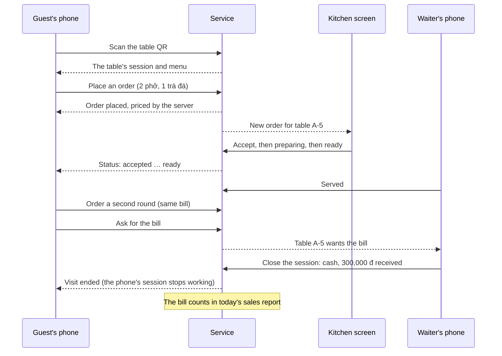

# Business overview: Restaurant ordering service

| Version | Date | Audience | Sources |
|---|---|---|---|
| 1.0 | 2026-10-19 | Owners, restaurant partners, investors, anyone who isn't a developer | [requirements.md](../sdlc/restaurant-ordering/requirements.md) v1.8, [architecture.md](../sdlc/restaurant-ordering/architecture.md) v1.8, [cost-estimate.md](../sdlc/restaurant-ordering/cost-estimate.md) v0.3, [STATUS.md](../sdlc/restaurant-ordering/STATUS.md) (gate log, risks) |

This document explains what the product is, who it serves, what release 1 does and doesn't do, what it would cost to run for real, and what must happen before real restaurants use it. It summarises the approved project documents and doesn't replace them: where they differ, the documents in `docs/sdlc/` win.

## 1. The product in one paragraph
A guest sits down, scans the QR code on the table with their phone, and orders from the menu without waiting for a waiter. The order goes straight to the kitchen's screen. Staff move it along (accepted, preparing, ready, served) and the guests watch its progress on their phones. Everyone at the table shares one running bill. When they've paid at the counter, a waiter closes the bill, the table is free again, and the day's sales appear in the manager's report. One service runs many restaurants at once (a SaaS, rented per restaurant), and each restaurant sees only its own data.

## 2. The problem it solves
| Today, without the service | With the service |
|---|---|
| Guests wait for a waiter to take the order, and again for the bill | Guests order from their own phone the moment they sit down, and can call a waiter or ask for the bill from the app |
| Orders taken by hand get lost or misread on the way to the kitchen | The kitchen reads exactly what the guest chose, with notes and options |
| Prices on paper menus drift from the till | The server prices every order from the current menu; the guest's phone can't change a price |
| Running out of a dish means a waiter has to go back to the table | The kitchen marks it sold out with one tap, and nobody can order it any more |
| The owner has no simple, shared view of what sold | A daily report per day: bills, orders, sales per payment method, top items, sales per table |
| A small restaurant can't build or run its own system | It rents one, set up in a day, with no developer |

## 3. Who uses it
| Role | Who they are | What they use | What they do |
|---|---|---|---|
| **Guest** | Anyone at a table. Anonymous: no account, no name, no phone number | Customer mobile app (Android, iOS) or customer web app in the browser | Scan the table QR, read the menu, order, follow their orders, see the bill, call a waiter |
| **Kitchen** | Cooks | Staff app (web, on a tablet): the kitchen screen | See new orders, accept them, mark them preparing and ready, reject a dish that ran out, mark items sold out |
| **Waiter** | Floor staff | Staff app (web, on a phone or tablet) | See every table, answer waiter calls, serve orders, order for guests without a phone, move a party to another table, take payment and close the bill |
| **Manager** | The restaurant's owner or manager | Staff app | Everything a waiter does, plus the menu, tables and QR codes, staff accounts, the restaurant profile, sales reports and the audit log |
| **Platform admin** | The operator of the service (us) | Admin console | Onboard new restaurants, suspend or reactivate them, manage other admins, answer staff privacy requests |

Each staff member works in exactly one restaurant. One restaurant is one branch: chains with several branches under one account are out of scope for release 1.

## 4. What a visit looks like

Rules guests and staff can rely on:
- **One table, one bill.** Everyone who scans the same table joins the same session and sees the same orders and bill.
- **All or nothing.** If one dish in an order is sold out, nothing in that order is placed, and the app names the dish.
- **Prices are fixed at order time.** If the manager raises a price at 19:00, orders placed at 18:59 keep the old price.
- **Guests can cancel** only until the kitchen accepts the order. After that, they ask a waiter.
- **A closed bill is never edited.** A mistake found later is fixed by a manager's correcting entry (a signed amount with a reason), counted on the day it's made, and recorded in the audit log.
- **Rotating a table's QR code** makes every printed copy of the old one stop working at once; guests already seated keep their session.

## 5. Release 1: what's in
Release 1 (`1.0.1`) went live on 2026-10-19. Priorities are MoSCoW: **M**ust, **S**hould, **W**on't this release.

| Area | Feature | Priority | In release 1 |
|---|---|---|---|
| Guest ordering | Scan the QR, open or join the table's session (FR-001) | M | Yes |
| | Browse the menu by category, prices, sold-out flags (FR-002) | M | Yes |
| | Place orders, several rounds on one bill (FR-003, FR-004) | M | Yes |
| | Follow the orders' status (FR-005) | M | Yes, refreshed every 60 s (see §6) |
| | Cancel an order before the kitchen accepts it (FR-006) | M | Yes |
| | See the running bill (FR-007) | M | Yes |
| | Call a waiter or ask for the bill (FR-008) | S | Yes |
| Staff and kitchen | Sign in with an own account and role (FR-010) | M | Yes |
| | Live order feed for the kitchen and waiters (FR-011) | M | Yes, refreshed every 15 s (see §6) |
| | Move orders through their stages (FR-012) | M | Yes |
| | Close the session and record the payment (FR-013) | M | Yes, plus corrections to closed bills |
| | Order for a guest without a phone (FR-014) | S | Yes |
| | Reject one dish of an accepted order (FR-015) | S | Yes |
| Menu | Categories and items: create, edit, reorder, hide, delete (FR-020) | M | Yes |
| | Sold out with one tap (FR-021) | M | Yes |
| | Photos of dishes (FR-022) | S | **No**: waits for the choice of image store (TBD-13) |
| | Options such as size or spice level, with price changes (FR-023) | S | Yes |
| | Vietnamese and English names (FR-024) | S | Yes |
| Tables | Tables, areas and seats (FR-030) | M | Yes |
| | Printable QR codes and rotation (FR-031) | M | Yes |
| | Floor view; open, move and close sessions (FR-032) | M | Yes |
| Restaurants and staff | Onboard a restaurant and its first manager (FR-040) | M | Yes |
| | Invite, change role, deactivate staff (FR-041) | M | Yes |
| | Restaurants can't see each other's data (FR-042) | M | Yes, tested on every operation group |
| | Suspend and reactivate a restaurant (FR-043) | S | Yes |
| | Edit the restaurant profile (FR-044) | M | Yes |
| Reports | Daily sales report for up to 93 days (FR-050) | M | Yes |

### Not in release 1
- **Decided out** (each needs a change request to add later): online payment and payment gateways; guest accounts, history and loyalty; reservations; delivery and take-away; inventory; kitchen printers; chains with several branches; e-invoices to the tax authority; waiter confirmation of guest orders (FR-016); CSV export of sales (FR-051).
- **The client apps themselves.** This project is the backend service only. The customer apps, staff app and admin console are separate projects; [build-from-scratch.md](build-from-scratch.md) describes how to build them. Until they exist, everything is driven through the API (the tests do exactly that).
- **Live push.** Screens refresh on a timer instead of being told instantly (§6).

## 6. How fast things appear (release 1)
Release 1 has no "push" channel to the screens. Each open screen asks the service "anything new?" on a timer: staff screens every 15 seconds, guest phones every 60 seconds. A screen always shows its own action at once (a cook sees their own tap, a guest their own order).

| What | Target in release 1 | Target once live push is added |
|---|---|---|
| A new order reaches the kitchen | ≤ 16 s for 95 % of orders, ≤ 20 s for 99 % | ≤ 2 s for 95 % |
| A status change reaches the guests | ≤ 62 s for 95 %, ≤ 75 s for 99 % | ≤ 2 s for 95 % |

Why: the push provider (Ably) was measured and works (about 50 ms delivery), but on the free plans it can't carry the launch load, and on paid plans it would be about 55–60 % of the monthly bill. The owner chose to launch without it (CR-013) and decide later. The acceptance runs measured a kitchen seeing orders in 3–4 s and guests seeing status changes in 22–57 s, inside these targets.

## 7. Quality promises (non-functional requirements)
Agreed by the product owner at G1. "Peak" means the dinner peak at launch: 500 restaurants, about 15,000 guest phones and 2,500 staff screens, about 300 requests a second (about 640 in release 1, because of the timers).

| Promise | Target |
|---|---|
| Guest screens load quickly | 95 % of menu, order and bill reads within 0.2 s at peak |
| Actions feel instant | 95 % of orders, cancels, status changes and closes within 0.3 s at peak |
| Reports are quick | A 31-day report within 3 s |
| The service is up | 99.9 % of valid requests succeed over 28 days (about 40 minutes of failures a month) |
| No order is lost or doubled | A guest's retry never creates a second order; an order the service confirmed is never lost |
| Data loss after a disaster | At most 5 minutes of data lost; back within 1 hour |
| Restaurants are isolated | Zero reads or writes across restaurants or across tables |
| Security level | OWASP ASVS level 2 and the OWASP API Security Top 10 |
| Old apps keep working | Every supported app version keeps working; old mobile versions are supported for 12 months |
| Bad releases are undone quickly | Rollback within 10 minutes |

What was proven before launch, and how far: every Must feature passed its acceptance test (21 of 21). Speed and reliability were measured at about 10 requests a second, not the 640 of a real peak, because the project runs on free plans. That gap is accepted for this release and must be closed before real restaurants use it (§10).

## 8. Data and privacy
- **Guests are anonymous.** No names, phone numbers, emails, payment cards or locations are collected. A phone gets a random ID that isn't stored. Free-text dish notes (which might say "no peanuts, for Lan") are cleared 30 days after the visit.
- **Staff data** is the minimum to sign in and run the restaurant: name, email, optional phone, role. Passwords are stored only as strong one-way hashes. A staff member can ask the operator for a copy of their data or its erasure; the operator handles it through the admin console.
- **Financial records** (orders, bills, payments) are kept for accounting. The working retention values, pending a legal review, are 10 years for orders and bills, 1 year for the audit log, and staff anonymised 30 days after deactivation.
- **No payment data.** Bills are paid at the counter and the staff record only the method (cash, card, bank transfer) and the amount, so card-industry rules (PCI-DSS) don't apply.
- **Law.** Vietnam's Personal Data Protection Law (in force 1 January 2026) and Decree 356/2025/ND-CP apply, as do accounting retention rules. Whether data may be stored outside Vietnam (the service runs in Singapore) has **not** had a legal review: the owner accepted that for release 1 because it holds test data only (TBD-10, risk R-04).
- **Audit trail.** Every staff action that touches money, access or the menu is recorded with who, what and when, in a log that can't be edited and shows any tampering.

## 9. What it costs
### Today
**$0 a month.** Release 1 runs entirely on free plans (Vercel Hobby, Neon Free, Upstash Free, Grafana Cloud Free). The free plans don't allow commercial use and can't carry real traffic, so today's production is a rehearsal environment with test data.

### For a real launch (estimate, US dollars a month)
From [cost-estimate.md](../sdlc/restaurant-ordering/cost-estimate.md) v0.3, a draft for the owner's review, not a quote.

| | Launch (500 restaurants) | 3× growth (1,500 restaurants) |
|---|---|---|
| Release 1's design (screens refresh on a timer) | ≈ 1,030 – 1,300 | ≈ 3,000 – 3,840 |
| With live push (Ably) | ≈ 1,540 – 1,740 | ≈ 3,700 – 4,350 |
| Menu photos, if built | + ≈ 470 | + ≈ 1,420 |
| **Per restaurant, release 1's design** | **≈ $2.10 – 2.60** | **≈ $2.00 – 2.60** |

What drives the bill, largest first: requests counted at Vercel's edge (every timer refresh is a request), the push provider if added, menu photos if built, then the database, which is cheap by comparison. Not included: staff, support, legal review, domain and app-store fees.

## 10. Where the project stands
The project ran as six phases, each closed by a gate the owner decided.

| Gate | Date | Decision |
|---|---|---|
| G1 Requirements baseline | 2026-10-13 | Approved |
| G2 Architecture baseline | 2026-10-15 | Approved with conditions (data residency before G5) |
| G3 Ready to build | 2026-10-15 | Approved |
| G4 Code complete | 2026-10-17 | Approved with conditions (menu photos waived) |
| G5 Release readiness | 2026-10-18 | Approved (free-plan gaps accepted) |
| G6 Launch accepted | 2026-10-19 | Approved with conditions |

**Release 1 is live as a learning project with test data only.** Before any real restaurant uses it, the G6 conditions must be met:

1. **Legal review** of data residency and retention (TBD-10, TBD-4): may the data live in Singapore, and for how long must records be kept?
2. **Paid plans** (Vercel Pro, Neon Launch or above), then the checks the free plans couldn't run: cold starts on Vercel Pro (R-12), a 7-day restore window (R-14), logs kept beyond one hour (R-20).
3. **Full-size load test** at 2× the dinner peak (about 1,280 requests a second) (R-16, R-09).
4. **Alerts loaded and fired once for real**, with the dashboards checked live (R-21); each scheduled job's run checked on production (R-23).
5. **Client apps built** (the customer apps, the staff app and the admin console), and the acceptance tests rerun through them.

## 11. Main risks in business terms
| Risk | What could happen | What protects against it | Status |
|---|---|---|---|
| A photographed QR code used away from the table (R-02) | Pranks: orders on strangers' bills | QR rotation, per-session order limits, staff cancel. Waiter confirmation (FR-016) could be added later | Open |
| A data leak between restaurants (R-03) | Every customer's trust lost at once | Two independent locks: every query names the restaurant, and the database itself refuses other restaurants' rows; tests for every operation group | Open, mitigated |
| Data residency law (R-04) | Singapore hosting may not be allowed for Vietnamese data | Legal review before real customers; region or provider change if needed | Accepted for test data only |
| Slow first request after a quiet spell (R-12) | A guest waits 5–7 s once in a while | Measure on paid plans; move to a container platform if it fails (CR-001) | Accepted on free plans |
| Polling feels slow (R-19) | The kitchen sees new orders up to about 18 s late | Pilot feedback; the interval is a client setting; live push can be added | Open |
| One person holds every role (R-07) | Nobody covers when the owner is away | Accepted for a learning project | Closed (accepted) |
| No alerts loaded (R-21) | An incident goes unnoticed | Alert rules are written and tested offline; load them before real customers | Accepted for test data only |

## 12. Success measures (KPIs)
Agreed at G1, measured in a pilot once real restaurants use the service.

| KPI | Target |
|---|---|
| KPI-1: guests order by themselves | ≥ 60 % of orders in pilot restaurants placed by guests (QR), 3 months after go-live |
| KPI-2: orders reach the kitchen in time | 99 % within the delay target (release 1: 20 s; 2 s once live push is added) |
| KPI-3: few wrong orders | < 1 % of orders cancelled or corrected because the table or an item was wrong |
| KPI-4: quick onboarding | A new restaurant set up (menu, tables, staff, printed QR codes) in ≤ 1 working day without a developer |

## 13. Glossary
| Term | Meaning |
|---|---|
| Table session | One visit to one table, from the first scan to the closed bill. Everyone at the table shares it |
| Round | One order a table sends to the kitchen; a visit can have many |
| Sold out | An item still on the menu that can't be ordered right now |
| Hidden | An item taken off the guest menu (but kept for past bills) |
| Correction (bill adjustment) | A manager's signed entry on a closed bill, with a reason; the bill itself never changes |
| Suspension | The operator pauses a restaurant (for example for non-payment): guests can't order, staff can sign in and read reports, no data is deleted |
| SaaS, tenant | Software rented as a service; each restaurant is one tenant |
| Gate (G1–G6) | A checkpoint where the owner approves the work so far before the next phase starts |
| CR | Change request: the formal way to change an approved document |
| VND, đồng | Vietnamese currency. Prices include VAT; there's no service charge in release 1 |
