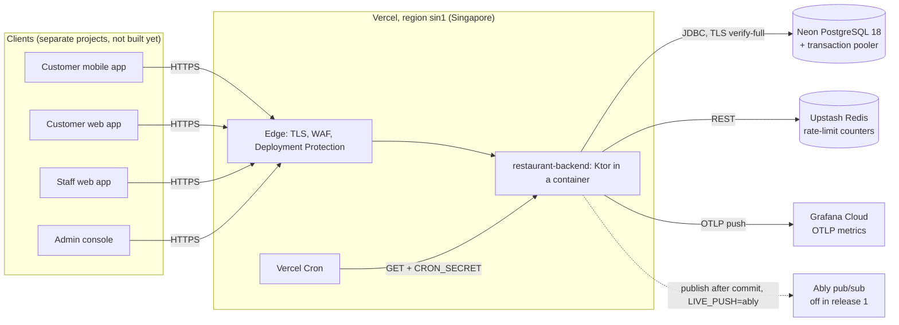
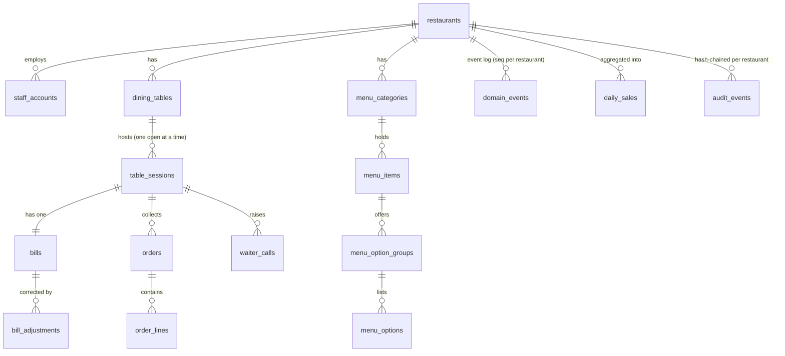

# Technical reference: restaurant-backend

| Version | Date | Audience | Code baseline |
|---|---|---|---|
| 1.0 | 2026-10-19 | A developer joining the project, a reviewer, the future client teams | `release/1.0.1` (production), contract `docs/api/openapi.yaml` 1.1.1 |

This is the map of the service: what it's made of, how a request flows through it, and the rules the code keeps. It summarises the approved documents and points to them for detail. When this page and a baselined document disagree, the baselined document wins:

| Topic | The source of truth |
|---|---|
| What the service must do | [requirements.md](../sdlc/restaurant-ordering/requirements.md) |
| How it's built, and why | [architecture.md](../sdlc/restaurant-ordering/architecture.md) and the [ADRs](../sdlc/restaurant-ordering/adr/) |
| Each feature in detail | [design/](../sdlc/restaurant-ordering/design/) (core-and-auth, restaurants, menu, tables, orders, realtime, reports) |
| The API | [`docs/api/openapi.yaml`](../api/openapi.yaml) |
| Engineering rules and gotchas | [`CLAUDE.md`](../../CLAUDE.md) |
| Phase, decisions, risks | [STATUS.md](../sdlc/restaurant-ordering/STATUS.md) |

## 1. System context


- **One deployable**: a Ktor 3 server in a JDK 25 container image (`Dockerfile.vercel`), run by Vercel's container runtime as a serverless function. Instances start on demand and scale to zero after 5 minutes idle, so the service keeps **no state in memory between requests**.
- **Every managed service is reached over the public internet with TLS and credentials**; there's no private network (R-06).
- **Trust boundaries**: internet → Vercel edge; edge → function; function → each managed service. Guests are anonymous and untrusted; staff are authenticated by the service itself (no external identity provider, ADR-0011).

## 2. Stack
| Concern | Choice | Version (from `gradle/libs.versions.toml`) | ADR |
|---|---|---|---|
| Language, runtime | Kotlin on the JVM | Kotlin 2.4.21, JDK 25 (Gradle toolchain) | — |
| HTTP server | Ktor (Netty engine) | 3.6.0 | — |
| JSON | kotlinx.serialization | 1.11.0 | — |
| DI | Koin | 4.2.2 | — |
| Database access | Exposed (transactions) + plain JDBC statements | Exposed 1.5.1, pgjdbc 42.7.14 | — |
| Pool | HikariCP | 7.1.0 | ADR-0004 |
| Migrations | Flyway (SQL files) | 13.10.0 | — |
| Database | Neon PostgreSQL 18, Singapore, transaction-mode pooler | — | ADR-0004 |
| Tenant isolation | Service checks + forced row-level security | — | ADR-0005 |
| Passwords | Argon2id via Bouncy Castle | bcprov 1.86 | ADR-0011 |
| Tokens | ES256 JWTs via auth0 java-jwt | 4.6.0 | ADR-0006, ADR-0011 |
| Rate limits | Vercel WAF per IP + Upstash Redis per key | — | ADR-0008 |
| Live updates | Event log in PostgreSQL, polled; Ably for push (off in release 1) | ably-java 1.8.2 | ADR-0003, CR-013 |
| Metrics | Micrometer OTLP registry → Grafana Cloud | Micrometer 1.17.1 | ADR-0009 |
| Logs | Logback + logstash JSON encoder to stdout | 1.6.5, 9.0 | — |
| Contract | Hand-written OpenAPI 3.1; responses validated in tests | networknt json-schema-validator 3.0.8 | ADR-0007 |
| Tests | JUnit, Ktor `testApplication`, Testcontainers PostgreSQL | Testcontainers 2.0.5 | — |
| Static checks | ktlint 1.8.0, detekt 1.23.8 (run on JDK 21), Kover 0.9.11 | — | — |
| Supply chain | CycloneDX SBOMs, Syft, Grype, Dependabot | CycloneDX 3.4.1 | — |

The ADRs: [0001 module layout](../sdlc/restaurant-ordering/adr/0001-module-layout.md) · [0002 Vercel](../sdlc/restaurant-ordering/adr/0002-deployment-platform-vercel.md) (accepted with conditions) · [0003 live updates](../sdlc/restaurant-ordering/adr/0003-live-updates.md) · [0004 Neon and pooling](../sdlc/restaurant-ordering/adr/0004-database-hosting-pooling.md) · [0005 tenant isolation](../sdlc/restaurant-ordering/adr/0005-tenant-isolation.md) · [0006 guest authentication](../sdlc/restaurant-ordering/adr/0006-guest-authentication.md) · [0007 OpenAPI contract](../sdlc/restaurant-ordering/adr/0007-openapi-contract.md) · [0008 rate limiting](../sdlc/restaurant-ordering/adr/0008-rate-limiting.md) · [0009 observability push](../sdlc/restaurant-ordering/adr/0009-observability-push.md) · [0011 built-in staff sign-in](../sdlc/restaurant-ordering/adr/0011-staff-identity-provider.md). 0010 is reserved for CR-001 (moving off Vercel, deferred).

## 3. Code layout
One Gradle module, packages by feature (ADR-0001), root package `io.github.phongmanh.restaurant`. About 20,000 lines of main code and 290 tests.

```
src/main/kotlin/io/github/phongmanh/restaurant/
  Application.kt            # the one `module` function application.yaml names
  core/                     # shared by every feature
    domain/                 # Caller, IDs, Money, DomainError
    application/            # Transactor, Idempotency, AuditLog, RetentionTask, RateLimiter port
    persistence/            # DatabasePools, ExposedTransactor, Jdbc helpers, repositories for core tables
    http/                   # Endpoints.kt (the route registry), endpoint(), job(), problem+json, ETag/If-Match
    auth/                   # staff and admin sign-in: domain, application, persistence, http, crypto
    config/                 # AppConfig: application.yaml + environment, startup checks
    observability/          # Micrometer OTLP registry, metric names
    ops/                    # generateSecrets (`./gradlew generateSecrets`); migrations run from persistence/Migrations.kt
  restaurants/              # tenants, profile, staff management, admins, audit read, privacy;
                            # ops/Operator.kt: `./gradlew operator` (first admin, last admin's TOTP)
  menu/                     # categories, items, option groups, sold out, MenuCatalog port
  tables/                   # tables, QR codes, table sessions, waiter calls, SessionAccess port
  orders/                   # orders, lines, bills, payments, corrections
  realtime/                 # event log, outbox, catch-up endpoints, Ably adapter
  reports/                  # daily sales aggregates, the report, the nightly rebuild
src/main/resources/
  application.yaml          # settings with ${ENV} substitution
  db/migration/V1…V11       # Flyway SQL
  auth/common-passwords.txt # the rejected-password list
```

Each feature has the same layers, and dependencies point inwards:

| Layer | Holds | May use |
|---|---|---|
| `domain` | Data classes, value types, state machines, pure rules | Nothing outside the feature's domain and `core.domain` |
| `application` | Services: one method per operation; role checks; transactions; ports other features call | `domain`, ports, `core.application` |
| `persistence` | Repositories (SQL), one method per query, every one taking a `RestaurantId` | `domain`, `core.persistence` |
| `http` | Routes, request and response bodies, input parsing | `application`, `core.http` |
| `<Feature>Module.kt` | The Koin module that wires the feature | Everything in the feature |

**Features don't read each other's tables.** They talk through ports, implemented by the owning feature: `orders` prices lines through `MenuCatalog` (menu), locks and closes sessions through `SessionAccess` (tables), and records sales through `SalesLedger` (reports); every feature writes events through `EventLog.append` (realtime) and reads names and time zones through `RestaurantDirectory` (restaurants).

## 4. The API
- **Contract**: [`docs/api/openapi.yaml`](../api/openapi.yaml), OpenAPI 3.1, version 1.1.1, **100 operations** (93 from 1.0.0 plus 7 `POST …/update` twins). Its `x-error-catalogue` lists 45 error codes. Rendered copy for reading: `api-docs.html` at the repository root (untracked; regenerate from the contract).
- **Base path** `/v1`. Within `/v1` only additive changes are allowed (NFR-COMPAT-01); CI fails on a breaking change against the G3 tag (`scripts/contract-breaking.sh`, oasdiff).
- **Route groups**: the path prefix decides the authentication.

| Prefix | Caller | Credential | Operations |
|---|---|---|---|
| `/v1/auth/*` | Anyone | None, a refresh cookie, or an access token (`me`, `password`) | 9 |
| `/v1/guest/*` | A guest device | Table-session token (ES256, `aud=guest`); the scan itself takes the QR token in the body | 11 |
| `/v1/staff/*` | Manager, waiter, kitchen | Staff access token (`aud=staff`) | 55 |
| `/v1/admin/*` | Platform admin | Admin access token (`aud=admin`, `amr` has `otp`) + `is_platform_admin` in the database | 25 |
| `/internal/jobs/*` | Vercel Cron | `Authorization: Bearer <CRON_SECRET>`; not in the contract | 5 |
| `/health` | Platform | None; never touches the database | 1 |

- **Wire format**: JSON in `snake_case`; unknown request fields ignored; absent optional fields left out (not `null`); IDs UUID v7; times RFC 3339 UTC with milliseconds (`2026-10-15T09:30:00.123Z`); money `{"amount": "125000", "currency": "VND"}`, the amount a string of whole đồng (`BIGINT` in the database).
- **Lists**: cursor pagination, `?limit=` (default 50, max 200) and `?cursor=`; answer `{"items": [...], "next_cursor": "..."}`.
- **Headers**: `X-Request-ID` on every response; `X-Client: <app>/<semver>` optional on requests (below the configured minimum → `426 client_upgrade_required`); `Idempotency-Key`, `ETag`/`If-Match`, `Retry-After` on every 429 and 503; `Cache-Control: no-store` on all `/v1` data except the menu reads (`private, no-cache` + `ETag`).
- **Body limit**: 64 KB of JSON (`413 payload_too_large`).
- **CORS**: an allow-list (`ALLOWED_ORIGINS`), for the customer web app only; credentials never cross origins. The staff and admin web apps call the API through a same-origin rewrite (`/api/*` → the API), so their refresh cookie belongs to the app's own address.

### Operations by tag
| Tag | Operations | Highlights |
|---|---|---|
| auth | sign-in, mfa, refresh, sign-out, links/inspect, invitations/accept, password-resets/complete, password, me | Same `401 invalid_credentials` for every sign-in failure |
| restaurants, staff, audit | profile read and update, members (invite, update, deactivate, reactivate, re-issue invitation, password reset), audit log | Manager-only writes; last-manager rule |
| admin, privacy | restaurants (onboard, update, suspend, reactivate), members per restaurant, admins (invite, deactivate, reset, TOTP reset), audit, staff export and erase | Every admin read of the audit log is itself audited |
| menu | guest menu, staff menu, categories and items CRUD and ordering, sold out, image (not built), admin menu read | Guest menu revalidated by `ETag` = menu version |
| tables | guest session open/join and read, waiter calls, floor view, tables CRUD, QR codes and rotation, staff open, move | One open session per table, enforced by a unique index |
| orders | guest place, list, read, cancel, bill; staff place, list, read, status, reject line, bill, close, adjustments, bills of a day | Server pricing; all lines or none |
| realtime | guest and staff events (catch-up), guest and staff realtime-token | Tokens answer `503` with `LIVE_PUSH=off` |
| reports | daily sales | Up to 93 days, reads aggregates only |

### Updates go through `POST …/update`
Vercel's edge evaluates `If-Match` on a `PATCH` against the function's response `ETag` **after** the function has run, and answers its own `412` even though the change was saved (defect D-1). So every update is `POST <path>/update` with `If-Match`; the seven `PATCH` operations of contract 1.0 stay, deprecated, bound to the same handler (CR-012). Never add a `PATCH`.

## 5. Life of a request
```mermaid
sequenceDiagram
  participant C as Client
  participant E as Vercel edge
  participant R as Route (endpoint())
  participant A as Authentication
  participant S as Service
  participant T as Transactor
  participant DB as PostgreSQL
  C->>E: POST /v1/guest/orders (Bearer, Idempotency-Key)
  E->>R: WAF passed
  R->>A: path group = guest
  A->>DB: session open? restaurant active? (globalTransaction)
  A-->>R: Caller.Guest(device, session, table, restaurant)
  R->>S: place(caller, input)
  S->>S: rate limit (Upstash), validation
  S->>T: inTransaction(restaurantId)
  T->>DB: SET LOCAL app.restaurant_id; idempotency row; lock session, bill; insert order, lines; event; audit
  T->>DB: COMMIT
  T-->>S: afterCommit actions (publish, if LIVE_PUSH=ably)
  S-->>C: 201 + ETag + Location + X-Request-ID
```

1. **Routing.** Every path is declared once in `core/http/Endpoints.kt`. Routes are declared with `endpoint()`, which authenticates by the path's group before the handler runs; the handler reads `call.caller()`. A route declared another way gets no authentication. The one exception is the QR scan (`qrCredential`), whose QR token in the body is the credential. Test IT-CORE-10 fails if Ktor's routes, the registry and the contract differ.
2. **Who's calling** comes from the token plus the database, never from the body. For staff, the restaurant, role, active flag and platform-admin flag are read from `staff_accounts` on every call, so a deactivation or role change takes effect at once. For guests, every call checks that the session is still open, so closing it revokes every guest token.
3. **Suspension** is checked centrally: each registry entry sets `allowedWhenSuspended` explicitly, and the authentication refuses the rest with `403 restaurant_suspended`.
4. **Check order**: 401 → 403 → 400 → 404 → 409/412. The role check happens before the body, `If-Match` or query is read, so a 403 reveals nothing. Manager-only service operations take a `RestaurantScope`, which only the role check creates.
5. **The transaction** (`Transactor.inTransaction(restaurantId)`) sets the tenant for row-level security, runs once (Exposed's retries are off, `defaultMaxAttempts = 1`), and runs remote calls only after commit (`tx.afterCommit`).
6. **Errors** are `DomainError`s mapped to `application/problem+json` with a stable `code`, `request_id` and, for 400s, an `errors` list of JSON Pointers. Stack traces and internals never reach clients.

## 6. Authentication
### Staff and admins (ADR-0011, core-and-auth §8)
| Piece | How |
|---|---|
| Password hash | Argon2id (m = 19 MiB, t = 2, p = 1), 16-byte salt, PHC string; re-hashed at sign-in when the parameters change; at most 4 hashes at once per instance (`503 service_busy` otherwise) |
| Password rules | 8–64 characters, any character, no composition rules, refused if on the common-password list or equal to the email |
| Sign-in | `POST /v1/auth/sign-in`. Every failure is the same `401 invalid_credentials` and runs Argon2id exactly once (a dummy hash when there's no usable account) |
| Lockout | 10 failures in 15 min lock the account for 15 min, stored in PostgreSQL (works when Redis is down); same 401; existing refresh tokens keep working |
| Admin MFA | TOTP (RFC 6238, 6 digits, 30 s, ±1 step), secret encrypted with AES-256-GCM; sign-in answers `mfa_required` + a 5-minute single-use `mfa_token`; `POST /v1/auth/mfa` finishes it; a time step can't be reused |
| Access token | ES256 JWT, 15 min; `iss`, `aud` (`staff`/`admin`), `sub`, `sid`, `amr`, `kid`; 30 s leeway |
| Refresh token | 256-bit random, stored as SHA-256; single use, rotated on every refresh; valid 12 h idle, 24 h from sign-in at most; reuse revokes the whole sign-in |
| Refresh cookie | `__Secure-rt-staff` / `__Secure-rt-admin`, `HttpOnly; Secure; SameSite=Strict`, path `AUTH_COOKIE_PATH` |
| Invitations, resets | One-time 256-bit token, stored hashed, 72 h / 24 h, in the URL fragment (`https://<staff app>/invite#<token>`); a new link voids the old; never stored in an idempotent response or a log |
| Ending access | A role change revokes sessions; deactivation, TOTP reset or erasure revokes sessions and voids every open link, in the same transaction |

### Guests (ADR-0006, tables §2–3)
- **QR code**: `https://<customer app>/t/<qrToken>`. The token is `base64url(38-byte payload).base64url(ES256 signature)`; the payload holds a format byte, key ID, restaurant ID, table ID and the table's `qr_key_version`. Nothing secret is stored: the code can be rebuilt from (restaurant, table, version). Rotation bumps the version, so old codes fail at once with `400 qr_token_invalid`.
- **Session token**: ES256 JWT, 6 h, `aud=guest`, `sub` = device ID, `sid`, `rid`; no table claim, because sessions move. Open/join is idempotent by design (one open session per table) and takes no `Idempotency-Key`, so no bearer token is ever stored for a replay.
- **Three separate key sets**: staff, guest and QR keys, each with `kid` so old and new keys overlap during rotation.

### Jobs
`job()` (`core/http/Jobs.kt`) checks `CRON_SECRET` in constant time before the handler runs.

### Authorisation
Role checks live in services. A summary of architecture §7's matrix ("own" = the caller's restaurant; anything outside scope → 404):

| Operation | Guest | Kitchen | Waiter | Manager | Admin |
|---|---|---|---|---|---|
| Read menu | Own restaurant | Own | Own | Own | Any |
| Edit menu | — | — | — | Own | — |
| Toggle sold out | — | Own | — | Own | — |
| Place order | Own session | — | Own | Own | — |
| Order status steps | Cancel in `placed` | accept, preparing, ready, served, reject | served, reject, cancel | All | — |
| Tables, QR rotation | — | — | — | Own | — |
| Open, move, close sessions | — | — | Own | Own | — |
| Staff management | — | — | — | Own (not the last manager) | Any |
| Reports, audit log | — | — | — | Own | Any |
| Onboard, suspend restaurants | — | — | — | — | Yes |

## 7. Tenant isolation
Isolation is the top-ranked quality goal, and it has two independent layers (ADR-0005):

1. **In the code**: every repository method takes a `RestaurantId` and filters by it. Another restaurant's or session's ID gives `404`, never `403`.
2. **In the database**: every tenant table has `restaurant_id`, **forced** row-level security and one policy, `tenant_isolation`, which compares it with `current_setting('app.restaurant_id')`. `Transactor.inTransaction(restaurantId)` sets that with `set_config(…, true)` (transaction-scoped, so it's safe through the transaction pooler). A transaction that forgets to set it sees **zero rows**.

| Database role | Used by | Rights |
|---|---|---|
| `migrator` | `./gradlew migrate`, from the owner's machine, direct connection (no pooler) | Owns the schema; DDL. Never in Vercel |
| `app` | `DATABASE_URL`, the main pool | DML only, no `BYPASSRLS`; no `UPDATE`/`DELETE` on `audit_events` |
| `app_platform` | `DATABASE_URL_PLATFORM`, a small pool | `BYPASSRLS`, for admin work that spans restaurants |

Which transaction to use:
- `inTransaction(restaurantId)`: all tenant work, including an admin's work on one restaurant.
- `platformTransaction`: admin work and writes that span restaurants only.
- `globalTransaction` (the `app` role, no tenant): hot-path reads of global tables only, such as the caller lookup on every request. A query staff can trigger on a global table (`staff_accounts`, `restaurants`) still filters by their restaurant.

`RowLevelSecurityTest` (IT-CORE-06) fails on a table that neither has forced RLS with the one policy nor sits on its `GLOBAL` list with a reason, and on any second, permissive policy.

## 8. Data model
Eleven Flyway migrations, all expand-only, create these tables:

| Migration | Tables | Owner feature |
|---|---|---|
| V1 core | `idempotency_keys`, `audit_events`, `audit_chain_heads` | core |
| V2 auth | `restaurants`, `staff_accounts`, `staff_sessions`, `staff_refresh_tokens`, `staff_mfa_challenges`, `staff_link_tokens` | core/auth, restaurants |
| V3 restaurants | (columns, policies) | restaurants |
| V4 event log | `event_counters`, `domain_events`, `outbox` | realtime |
| V5 menu | `menu_state`, `menu_categories`, `menu_items`, `menu_option_groups`, `menu_options` | menu |
| V6 tables | `dining_tables`, `table_sessions`, `waiter_calls` | tables |
| V7 orders | `bills`, `orders`, `order_lines`, `bill_adjustments` | orders |
| V8 daily sales | `daily_sales`, `daily_sales_payment`, `daily_sales_table`, `daily_sales_item` | reports |
| V9 event publishing | (outbox columns) | realtime |
| V10 reconciliation | `sales_reconciliation` | reports |
| V11 note retention | (columns for clearing correction notes) | orders |



Key properties:
- **Money** is `BIGINT` đồng. **Order lines snapshot** names, unit price, options and totals, so later menu edits never change a past bill.
- **Optimistic locking**: a `version` column on the versioned resources (restaurant profile, menu categories and items, tables, sessions, orders, bills), plus `menu_state.version` for the whole menu; the `ETag` carries it.
- **Event sequence**: `seq` comes from a per-restaurant counter (`event_counters`), taken late in the transaction, so commit order equals sequence order and a client's cursor never skips a late commit.
- **Audit**: `audit_events` is append-only, hash-chained per restaurant (plus a platform chain), with the chain head updated in a before-commit hook, so it is always the last lock taken.
- **Daily sales**: four aggregate tables, updated in the transaction that closes a bill and rebuilt nightly from the raw rows. A bill counts on the restaurant's local day it was closed.

## 9. Correctness rules the code keeps
These are the lessons the build turned up; [`CLAUDE.md`](../../CLAUDE.md) holds the full list with sources.

| Concern | Rule |
|---|---|
| Retries | `Idempotency-Key` on order placement (guest and staff), session close and restaurant onboarding, stored in the same transaction; replay returns the stored answer, a different body → `422`, in progress → `409`. Kept 24 h |
| Natural idempotency | Where a constraint already makes a retry harmless (session open/join, waiter calls merged within 60 s, sold-out toggle, suspend), no key is taken |
| Secrets in replays | One-time links and bearer tokens are never stored with an idempotent response; a replay issues a fresh one |
| Concurrent edits | Versioned resources need `If-Match`: missing → `428`, stale → `412` |
| Lock order | dining table → table session → bill → order rows → daily sales rows → event counter → audit chain head. Skipping a step keeps the order of the rest |
| Lock mode | Lock a row you'll update with `FOR NO KEY UPDATE` or `FOR UPDATE`, never `FOR SHARE` (two share locks then updates deadlock) |
| Lock, then join | Lock with a query on the row's own table, then read it with its joins, or a concurrent change to a join column turns a `412` into a `404` |
| Create unless exists | `INSERT … ON CONFLICT … DO NOTHING`, then read; any error aborts a PostgreSQL transaction |
| Rules over several rows | "At least one active manager" and similar take `pg_advisory_xact_lock` on their scope; menu writes lock the restaurant's `menu_state` row first |
| Remote calls | Only in `tx.afterCommit`; a failing after-commit action is logged and skipped |
| Binding | Times bound as `timestamptz` (an `Instant` → `OffsetDateTime`), `now` from the injected `Clock`; nullable parameters cast (`?::uuid`) |
| Database TLS | Every URL off `localhost` uses `sslmode=verify-full`; `JdbcTarget.parse` refuses weaker |
| Privacy in logs | No emails, names, phones, notes, IPs, passwords or tokens; pgjdbc's `logServerErrorDetail=false`, Exposed's logger at ERROR, Hikari properties as strings |
| Unknown values | Clients accept enum values and fields they don't know, which keeps new values additive within `/v1` |

## 10. Live updates: the event log
Every state change writes a `domain_events` row in its own transaction (`EventLog.append`). Clients read the log after a cursor:

- `GET /v1/guest/events?after=<seq>&limit=100`: the session's events, plus **snapshots** of the orders and waiter calls they name (each in its current state, once).
- `GET /v1/staff/events?after=<seq>&limit=100`: the whole restaurant's events, all roles.
- Without `after`: an empty answer with the starting `cursor`. An `after` older than the 7 days kept, or ahead of the latest: `reset: true`, reload.

Event types: `TableSessionOpened`, `TableSessionMoved`, `TableSessionClosed`, `WaiterCalled`, `WaiterCallAcknowledged`, `MenuChanged` (staff only), `OrderPlaced`, `OrderStatusChanged`, `OrderLineRejected`, `BillClosed`, `BillAdjusted`. New types are additive.

**Release 1 (`LIVE_PUSH=off`, CR-013)**: no outbox rows, no Ably; the two `realtime-token` routes answer `503`. Clients poll every 15 s (staff) and 60 s (guests), ±20 % jitter, and catch up at once after their own write and on returning to the foreground. **With `LIVE_PUSH=ably`** the request publishes a thin "something changed" message after commit to `restaurant.<id>.staff` or `session.<id>`, the outbox sweep publishes what a request didn't, and clients subscribe with subscribe-only token requests. The event log stays the source of truth either way.

## 11. Scheduled jobs
Vercel Cron calls each with a `GET` and the cron secret. Each is idempotent, works in bounded batches and holds `pg_try_advisory_xact_lock` on its scope. On the Hobby plan each runs once a day (schedules in `vercel.json`, UTC):

| Route | Schedule (Hobby) | Designed for Pro | Work |
|---|---|---|---|
| `/internal/jobs/sales-reconcile` | 20:00 | Hourly, each restaurant after its local 03:00 | Rebuild the last 2 days of daily aggregates; record it in `sales_reconciliation` |
| `/internal/jobs/retention` | 20:15 | Daily | Runs every bound `RetentionTask`. Built: clearing order-line and correction notes 30 days after close |
| `/internal/jobs/event-purge` | 20:30 | Hourly | Delete events (and sent outbox rows) older than 7 days |
| `/internal/jobs/session-auto-close` | 20:45 | Hourly | Close empty sessions idle for 2 h |
| `/internal/jobs/outbox-sweep` | 21:00 | Every minute | Publish outbox rows a request didn't (no work with `LIVE_PUSH=off`) |

### Designed but not built in release 1
Found while writing this reference by comparing core-and-auth §10 and architecture §6 with the code. None of these blocks a test-data release, but each must exist before real customers (data minimisation, NFR-PRIV-01, NFR-SEC-03):

| Designed work | Design | Effect of its absence |
|---|---|---|
| `/internal/jobs/purge`: idempotency keys older than 24 h; expired refresh tokens, MFA challenges and links | core-and-auth §4, §9, §10 | These tables grow without bound; expired rows hold only hashes |
| `/internal/jobs/audit-export`: the day's audit entries to locked object storage | core-and-auth §12 | The audit log exists only in PostgreSQL |
| Retention: anonymise staff 30 days after deactivation | architecture §6, restaurants §10 | Deactivated staff keep their name and email until erased by request (the erase endpoint works) |
| Retention: archive orders and bills older than 2 years | architecture §6 | Nothing is 2 years old yet |
| Retention: delete replaced menu images after 30 days | menu §6 | No images exist (FR-022 not built) |

## 12. Rate limits
A `RateLimiter` port with an Upstash adapter: fixed windows, key `<APP_ENV>:rl:<policy>:<subject>:<window>` (the environment prefix because staging and production share one free database, CR-015). Over the limit → `429 rate_limited` with `Retry-After`. If Upstash fails, application limits **fail open** and the WAF still applies.

| Policy | Subject | Limit |
|---|---|---|
| Sign-in / MFA / refresh / links | IP | 30 / 10 / 120 / 10 per minute |
| Password change | Staff member | 5 per 15 min |
| QR scan (open/join) | Device, table, IP | Per tables §9 |
| Orders | Session, staff member, restaurant | ≤ 10 per minute per session; 300 per minute per restaurant (ST-06 measured it) |
| Waiter calls | Session | Repeats within 60 s merge |
| Reports | Staff member | 30 per minute |
| WAF `auth-per-ip` on `/v1/auth/` | IP | 60 per 60 s on production (300 on staging for load runs) |

## 13. Configuration
`application.yaml` reads environment variables into one `AppConfig`. The service **refuses to start** when a required setting is missing, and names every missing one. With `APP_ENV=production` it also requires `https` app URLs and no `localhost` origin (`DeployedSettingsTest` runs those checks in CI against each committed env file).

| Setting | Secret | Purpose |
|---|---|---|
| `APP_ENV` | No | `dev` and `test` (local: rate limits counted in memory), `staging`, `production` (extra start-up checks); prefixes Upstash keys and tags metrics `deployment.environment` |
| `PORT` | No | 8080 |
| `AUTH_ISSUER` | No | The tokens' `iss`; a fixed name, since each deployment URL differs |
| `AUTH_COOKIE_PATH` | No | The refresh cookie's path: `/api/v1/auth` on production (Q-29), for the web apps' `/api` rewrite; `/v1/auth` where clients call the API directly |
| `STAFF_APP_URL`, `ADMIN_APP_URL`, `CUSTOMER_APP_URL` | No | Where invitation, reset and QR links point. Placeholders (`*.production.example`) until the apps exist |
| `ALLOWED_ORIGINS` | No | CORS allow-list |
| `LIVE_PUSH` | No | `off` (release 1) or `ably` |
| `MIN_VERSION_CUSTOMER_ANDROID`, `MIN_VERSION_CUSTOMER_IOS` | No | Forced-update levers (`426`) |
| `DATABASE_MAX_POOL_SIZE`, `DATABASE_PLATFORM_MAX_POOL_SIZE` | No | Hikari pools (up to 10 per instance) |
| `DATABASE_URL`, `DATABASE_URL_PLATFORM` | Yes | The `app` and `app_platform` roles through Neon's pooler, `sslmode=verify-full` |
| `STAFF_JWT_KEYS`, `GUEST_JWT_KEYS`, `QR_SIGNING_KEYS` | Yes | ES256 key sets with `kid`s |
| `TOTP_ENCRYPTION_KEYS` | Yes | AES-256-GCM keys for admin TOTP secrets |
| `EMAIL_HMAC_KEY` | Yes | Pseudonymises emails for the failure counter |
| `CRON_SECRET` | Yes | The jobs' bearer secret |
| `UPSTASH_REDIS_REST_URL`, `UPSTASH_REDIS_REST_TOKEN` | Yes | Rate-limit store |
| `ABLY_API_KEY` | Yes | Only with `LIVE_PUSH=ably` |
| `OTEL_EXPORTER_OTLP_ENDPOINT`, `OTEL_EXPORTER_OTLP_HEADERS` | Yes (header) | Grafana Cloud OTLP |

Committed non-secret files: `deploy/staging/staging.env`, `deploy/production/production.env`. Secrets live in git-ignored `.env.<environment>` files on the owner's machine and in Vercel's environment variables. `./gradlew generateSecrets` makes every generated secret.

## 14. Observability
- **Metrics** (ADR-0009) are pushed over OTLP, because there's no stable instance to scrape: RED per route (`ktor_http_server_requests_milliseconds_*`), pool usage and wait, JVM, business meters (orders placed, sessions open, feed delay), each job's counts with a `…_timestamp_seconds` of its run. Grafana adds the unit and `_total` to Micrometer's names.
- **Alerts and dashboards as code** in `deploy/observability/`: `rules.yaml` (fast and slow burn-rate alerts for the three SLOs, plus `OutboxBacklogOld`, `RealtimePublishFailing`, `ReconcileMismatch`, `ReconcileFailed`, `ReconcileLagging`, `RateLimitFailingOpen` and `DatabasePoolWaiting`), `rules-test.yaml` (promtool cases, run in the build by `AlertRulesTest`), three dashboards (service overview, order flow, database) and [`runbooks.md`](../../deploy/observability/runbooks.md). Every selector filters `job="restaurant-backend"` and `deployment_environment="production"`; `MetricNamesTest` checks each against a captured push. **Not loaded into Grafana yet** (R-21).
- **Logs**: JSON to stdout with `call_id`, pseudonymous `restaurant_id` and deployment ID; Vercel Hobby keeps them for one hour, with no drain (R-20).
- **Request ID**: `X-Request-ID` on every response and in every problem body.
- **Audit log**: in PostgreSQL, readable by managers (their restaurant) and admins (any, audited).

## 15. Build, test and CI
`./gradlew build` runs what CI runs: compile, ktlint, detekt (on a JDK 21 toolchain, because detekt 1.23.8 crashes on JDK 25), unit and integration tests, the Kover gate (≥ 80 % lines in services and domain; 98.9 % at G4), the route-test matrix and the alert-rule tests. Gradle downloads JDK 25 if missing; integration tests need Docker (Testcontainers PostgreSQL 18).

| Test kind | Where | What it proves |
|---|---|---|
| Unit | `src/test`, fakes | Domain rules, state machines, parsing |
| Integration | `testApplication` + Testcontainers | Every route against a real PostgreSQL with RLS, idempotency, `If-Match`, concurrency (two writers at once), the authorisation cases |
| Contract | `ContractCheck` in every `testApp` call | Each response's status, media type and fields are in the contract |
| Route-test matrix | `RouteLog`, `scripts/route-matrix.py` | Every documented 401, 400, 404 and success of every operation has a test that produced it; `scripts/route-matrix-allowed.txt` lists the only waived gaps (FR-022's image routes) |
| Registry | IT-CORE-10, IT-CORE-11 | Routes = registry = contract; each `PATCH` has a `POST` twin that answers alike |
| System (staging/production) | `./gradlew systemTest -PstagingUrl=…` | The acceptance scenarios AT-001 to AT-050 through the API on a deployment |
| Load, ZAP, restore | `loadTest`, `zapScan`, restore drill | Phase 5's NFR tests, scaled to the free plans |

CI (`.github/workflows/ci.yml`) has three jobs: **build** (the above, plus the libraries' SBOM and Grype: High or Critical with a fix fails), **contract** (Redocly lint, oasdiff against the G3 tag) and **image** (builds `Dockerfile.vercel`, its SBOM with Syft, Grype). Dependabot proposes weekly updates for Gradle, Actions and the pinned Docker base images.

## 16. Deployment in one paragraph
Vercel builds the image from source for each project (`restaurant-staging`, `restaurant-production`), both on the free Hobby account, both production deployments of their own projects with Deployment Protection on (test clients send the bypass header). Staging's public alias is removed after every deploy; production's `restaurant-production.vercel.app` stays public for the client apps (Q-29). Each has its own Neon project in Singapore; they share one Upstash database with environment-prefixed keys. Migrations run first, from the owner's machine, and are expand-only, so the running deployment keeps working. A release is `deploy/release.sh production --env`; a rollback is `deploy/switch.sh production <deployment ID>` (2 s measured). The [operations handbook](operations-handbook.md) has the procedures.

## 17. Known limits and technical debt
| Item | Why it exists | Tracked as |
|---|---|---|
| Cold starts of 5–7 s on the free plan | JVM container on serverless; scale to zero after 5 min | R-01, R-12, CR-001 (deferred) |
| No live push | Cost and free-plan limits | CR-013, R-19 |
| FR-022 images not built | Image store not chosen | TBD-13, G4 waiver |
| Jobs designed but not built | §11 above | Q-28 |
| Contract `servers` is a placeholder | No fixed public URL yet | — |
| App URLs are placeholders | No client apps yet | release-checklist §4 |
| Hand-written contract can drift | ADR-0007 | D-01: contract check on every test response, IT-CORE-10 |
| Vercel's edge may rewrite more HTTP semantics | D-1 found one | R-18 |
| One shared Upstash database | Free plan allows one | CR-015, R-22 |
| Logs kept 1 hour, no drain | Hobby plan | R-20 |
