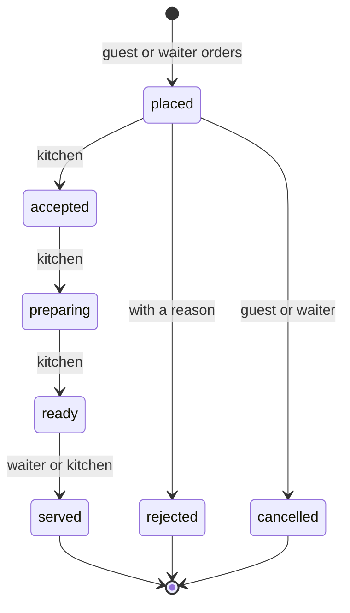

# User guides: guests, staff, managers and admins

| Version | Date | Audience | Sources |
|---|---|---|---|
| 1.0 | 2026-10-19 | Restaurant staff and managers, platform admins, the teams building the apps, testers | requirements.md §3, the feature designs, `docs/api/openapi.yaml` 1.1.1 |

**About these guides.** Release 1 is the backend service; the apps people will tap on are separate projects that don't exist yet ([build-from-scratch.md](build-from-scratch.md)). So each guide describes the task as the person experiences it, and every step names the API operation behind it. That makes the guides useful three ways: as the basis for the apps' help pages, as the screen list for the app teams, and as a script for testers who drive the API directly today.

## Contents
1. [Before you start](#1-before-you-start)
2. [Platform admin](#2-platform-admin)
3. [Manager](#3-manager)
4. [Waiter](#4-waiter)
5. [Kitchen](#5-kitchen)
6. [Guest](#6-guest)
7. [What the messages mean](#7-what-the-messages-mean)
8. [Questions](#8-questions)

## 1. Before you start
### Roles at a glance
| You are | You use | You can |
|---|---|---|
| Guest | The customer app or web page opened from the table's QR code | Order, follow your orders, see the bill, call a waiter |
| Kitchen | Staff app, kitchen screen | Move orders through cooking, reject a dish, mark items sold out |
| Waiter | Staff app | Run the floor: tables, waiter calls, serving, ordering for guests, moving parties, payment |
| Manager | Staff app | Everything a waiter does, plus menu, tables and QR codes, staff, profile, reports, corrections, audit log |
| Platform admin | Admin console | Onboard and suspend restaurants, manage admins, answer privacy requests |

### Your account (all staff)
- **You join by invitation.** Your manager (or an admin) creates your account and gives you a one-time link. It works once, for 72 hours. If it expires, ask for a new one; the old link then stops working.
  - The link page greets you by name (`POST /v1/auth/links/inspect`), then you choose a password (`POST /v1/auth/invitations/accept`).
  - **Password rules:** 8 to 64 characters, any characters including spaces. It can't be a common password or your email. There are no "must contain a digit" rules: a long phrase is best.
  - **Admins** also set up an authenticator app (Google Authenticator, Authy, 1Password and the like) during this step: scan the QR code shown, then type the 6-digit code to finish.
- **Signing in** (`POST /v1/auth/sign-in`): email and password. Admins then type the current 6-digit code (`POST /v1/auth/mfa`).
  - A wrong email or password always gives the same message, on purpose.
  - After 10 failed attempts in 15 minutes your account is locked for 15 minutes. Being signed in elsewhere isn't affected.
- **Staying signed in:** you stay signed in through a shift; the app renews your access quietly (`POST /v1/auth/refresh`). You sign in again after 12 hours without use, and at least once every 24 hours.
- **Changing your password** (`POST /v1/auth/password`) signs you out everywhere; sign in again with the new one.
- **Forgot your password?** Ask your manager (or, for a manager, an admin) for a reset link. It works once, for 24 hours (`POST /v1/auth/password-resets/complete`), and signs you out everywhere.
- **Signing out** (`POST /v1/auth/sign-out`) ends this device's session. Leave shared tablets signed out at the end of the day.

## 2. Platform admin
You run the service for every restaurant. Every admin action is recorded in the audit log.

### 2.1 Onboard a restaurant
1. Collect: the restaurant's name and address; its time zone (default `Asia/Ho_Chi_Minh`); its languages (`vi`, optionally `en`); the owner's contact (name, email, phone); and the first manager's email and display name.
2. **Create it** (`POST /v1/admin/restaurants`). The app sends an `Idempotency-Key`, so a double tap or a retry creates one restaurant, not two.
3. **Pass on the invitation link** shown in the answer to the first manager, through a channel you trust (in person, a phone call, a message you know reaches them). It's shown once. If you lose it, re-issue it (`POST /v1/admin/restaurants/{id}/members/{staffId}/invitation`); the old one stops working.
4. The manager takes it from there ([§3.1](#31-set-up-a-new-restaurant)). Target: a new restaurant running within one working day.

If the email already belongs to an account, nothing is created (`email_in_use`): each person has one account in one restaurant.

### 2.2 Look after restaurants
| Task | Operation |
|---|---|
| List or find restaurants | `GET /v1/admin/restaurants` |
| Read one, including its status and owner contact | `GET /v1/admin/restaurants/{id}` |
| Edit details, including the owner contact | `POST /v1/admin/restaurants/{id}/update` (with `If-Match`) |
| Read its menu (read only) | `GET /v1/admin/restaurants/{id}/menu` |
| Manage its staff (invite, change role, deactivate, reactivate, reset link) | `/v1/admin/restaurants/{id}/members/…` |
| Read its audit log | `GET /v1/admin/audit-events?restaurant_id=…` (your read is itself recorded) |

### 2.3 Suspend and reactivate
For non-payment or abuse. **Suspend** (`POST /v1/admin/restaurants/{id}/suspend`, with a reason only admins can read):
- guests can't open a table, order or call a waiter; guests already seated can still read their orders and bill;
- staff can sign in and read the restaurant profile; managers can read reports and the audit log; nothing else;
- no data is deleted and nobody is signed out.

**Reactivate** (`…/reactivate`) restores everything at once. Both are safe to repeat.

### 2.4 Other admins
| Task | Operation | Note |
|---|---|---|
| Invite an admin | `POST /v1/admin/admins` | They set up an authenticator when accepting |
| Deactivate an admin | `POST /v1/admin/admins/{id}/deactivate` | Not yourself; never the last active admin |
| Reset an admin's password | `POST /v1/admin/admins/{id}/password-reset` | Gives a 24-hour link |
| Reset a lost authenticator | `POST /v1/admin/admins/{id}/totp-reset` | Back to "invited" with a new link; the only admin left needs the operator command (operations handbook §10) |

### 2.5 Privacy requests from staff
A staff member may ask for a copy of their personal data or for its erasure. Follow [operations-handbook.md §10](operations-handbook.md#staff-privacy-requests-nfr-priv-01): check who's asking, export (`GET /v1/admin/staff-accounts/{id}/export`), erase if asked (`POST …/erase`), and record the date answered. If erasing removed the last manager, invite a new one.

## 3. Manager
### 3.1 Set up a new restaurant
A checklist for the first day, in order:

| # | Step | Where |
|---|---|---|
| 1 | Accept your invitation, choose a password, sign in | §1 |
| 2 | Check the profile: name, address, time zone, opening hours, languages | §3.2 |
| 3 | Create the menu categories, in the order guests should see them | §3.3 |
| 4 | Add the items, with prices, descriptions, options and English names if you serve foreign guests | §3.3 |
| 5 | Create the tables, by number or name, with area and seats | §3.4 |
| 6 | Print the QR codes and stick one on each table | §3.4 |
| 7 | Invite your staff (waiters, kitchen, other managers) and hand them their links | §3.5 |
| 8 | Test: scan one table with your own phone, place an order, move it through the kitchen, close the bill | §4–§6 |

### 3.2 Restaurant profile
Read it (`GET /v1/staff/restaurant`) and edit it (`POST /v1/staff/restaurant/update`): name, address, time zone, opening hours and languages (`vi`, `en`). The time zone matters: reports count each bill on the **local** day it was closed. If someone else edited the profile since you opened it, your save is refused (`precondition_failed`): reload and try again.

### 3.3 Menu
The menu is categories holding items. Everything you write is in Vietnamese, with optional English; guests who choose English see the Vietnamese text where no English is given.

**Categories**
| Task | Operation | Rules |
|---|---|---|
| Create | `POST /v1/staff/menu/categories` | Goes last. Name unique |
| Reorder | `PUT /v1/staff/menu/categories/order` | Send every category once, in the new order |
| Edit, hide | `POST /v1/staff/menu/categories/{id}/update` | `active: false` hides the whole category from guests |
| Delete | `DELETE /v1/staff/menu/categories/{id}` | Only an empty category |

**Items**
| Field | Rule |
|---|---|
| Category | Required |
| Name (vi, en) | Vietnamese required, ≤ 100 characters; unique within the category |
| Description (vi, en) | Optional, ≤ 500 characters |
| Price | Whole đồng, 0 to 100,000,000, **including VAT** (bills show no separate VAT line, and there's no service charge) |
| Active | Off hides the item from guests; past bills keep it |
| Option groups | E.g. "Size" (choose exactly 1) or "Toppings" (choose 0 to 3): each group has a minimum and maximum number of choices, and each option a price change (can be 0) |

| Task | Operation |
|---|---|
| Create | `POST /v1/staff/menu/items` (goes last in its category) |
| Edit | `POST /v1/staff/menu/items/{id}/update`. Sending option groups replaces the whole set |
| Reorder within a category | `PUT /v1/staff/menu/categories/{id}/items/order` |
| Mark sold out / available | `PUT /v1/staff/menu/items/{id}/sold-out` (kitchen can too) |
| Delete | `DELETE /v1/staff/menu/items/{id}`. Past orders keep its name and price |
| See the whole menu, hidden items included | `GET /v1/staff/menu` |

Limits: 50 categories and 1,000 items per restaurant. Guests see changes on their next menu load. **Price changes never touch orders already placed.** Photos aren't available in release 1.

**Hidden vs sold out:** hide an item you've stopped selling; mark sold out an item you've run out of today. Both stop new orders; sold-out items still show to guests, greyed out.

### 3.4 Tables and QR codes
| Task | Operation | Rules |
|---|---|---|
| Create a table | `POST /v1/staff/tables` | Number or name (e.g. `A-5`), unique; optional area and seats. Up to 300 tables |
| Edit, disable | `POST /v1/staff/tables/{id}/update` | Can't disable a table with guests at it |
| Delete | `DELETE /v1/staff/tables/{id}` | Can't delete a table with guests; its printed code stops working |
| One table's QR code | `GET /v1/staff/tables/{id}/qr-code` | |
| Every QR code, for a print sheet | `GET /v1/staff/tables/qr-codes` | |
| Rotate one code | `POST /v1/staff/tables/{id}/qr-code/rotate` | Old prints stop working **at once**; seated guests keep their session. Reprint that table |
| Rotate every code | `POST /v1/staff/tables/qr-codes/rotate-all` | For a leak: every printed code stops working. Reprint all |

**Printing:** print each code at least 3 cm wide. The code is a web address; phones with the customer app open the app, others open the web page.

**When to rotate:** someone photographed a code and orders arrive from people who aren't there; a table card went missing; you suspect misuse. Rotating is cheap: do it and reprint.

### 3.5 Staff
| Task | Operation | Rules |
|---|---|---|
| List, read | `GET /v1/staff/members`, `…/{id}` | |
| Invite | `POST /v1/staff/members` | Email, display name, role (`manager`, `waiter`, `kitchen`), optional phone. You get a 72-hour link to hand over. Up to 100 invited and active accounts |
| Re-issue an invitation | `POST /v1/staff/members/{id}/invitation` | The old link stops working |
| Change name, phone, role | `POST /v1/staff/members/{id}/update` | A role change signs them out everywhere |
| Password reset link | `POST /v1/staff/members/{id}/password-reset` | 24 hours |
| Deactivate | `POST /v1/staff/members/{id}/deactivate` | Signs them out everywhere and voids their links, at once |
| Reactivate | `POST /v1/staff/members/{id}/reactivate` | While not yet anonymised |

The restaurant always keeps at least one active manager: you can't demote or deactivate the last one, including yourself (`last_manager`). When someone leaves, **deactivate them the same day**.

### 3.6 Everything a waiter does
Managers can do every waiter task in [§4](#4-waiter) and every kitchen step in [§5](#5-kitchen).

### 3.7 Correct a closed bill
A closed bill is never edited. If you find a mistake afterwards (a dish billed wrongly, the wrong payment method recorded, a goodwill refund), add a **correction** (`POST /v1/staff/table-sessions/{id}/bill/adjustments`):
- a signed amount (negative for money returned, positive for money still owed);
- the payment method it concerns (`cash`, `card`, `bank_transfer`);
- a reason (`wrong_item_billed`, `wrong_payment_method`, `goodwill`, `other`) and an optional note. The note is cleared after 30 days; amount, method and reason stay.

The correction counts in reports on the **day you make it**, not the day of the bill, and it's recorded in the audit log.

### 3.8 Reports
`GET /v1/staff/reports/daily-sales?from=2026-10-01&to=2026-10-31`, up to 93 days. For each local day: sessions, orders, gross sales, sales per payment method, top items by quantity and revenue, sales per table, and totals for the range.
- Only closed bills count, and only lines that weren't cancelled or rejected.
- A bill counts on the local day it was **closed**: a table that sat down at 23:30 and paid at 00:20 counts on the second day.
- Corrections count on the day they were made.
- Today's figures are up to date the moment a bill closes; each night the service recounts the last two days from the bills and fixes any difference.

Bills of one day (waiters can see these too): `GET /v1/staff/bills?date=…`.

### 3.9 Audit log
`GET /v1/staff/audit-events`: who did what, and when, in your restaurant: price edits, staff and role changes, QR rotations, status changes, closes, corrections, sign-ins and failures. It's read-only and shows no IP addresses. Use it to answer "who changed this price?" or "who closed table 7?".

## 4. Waiter
### 4.1 The floor view
`GET /v1/staff/tables` shows every table, by area and number: **free** or **occupied**, and for an occupied one the time it opened, its number of orders, its running total, and any open waiter calls. Keep it open during service; it refreshes itself every 15 seconds.

### 4.2 Waiter calls
Guests can call you or ask for the bill from their phones. Open calls are listed oldest first (`GET /v1/staff/waiter-calls`), with the table number and the kind (`call_waiter` or `request_bill`). Go to the table, then **acknowledge** the call (`POST /v1/staff/waiter-calls/{id}/acknowledge`), so colleagues don't go too. Repeated taps from the same table within a minute arrive as one call.

### 4.3 Seat guests without a scan
For guests without a phone, or to start a table yourself: `POST /v1/staff/tables/{id}/session` opens the table's session, or returns the one already open.

### 4.4 Order for a guest
`POST /v1/staff/table-sessions/{id}/orders`: the same rules as a guest's order (§6.3); the order is marked as placed by you.

### 4.5 Follow and serve orders
- The order list (`GET /v1/staff/orders`) shows the open orders of every occupied table, oldest first, and can be filtered by status.
- When the kitchen marks an order **ready**, take it to the table and mark it **served** (`POST /v1/staff/orders/{id}/status` with `served`).
- You can also **reject** an order still in `placed` (with a reason: `item_unavailable`, `kitchen_closed`, `duplicate_order`, `not_at_table`, `customer_request`, `other`) or **cancel** it, for example when guests change their mind or an order came from someone not at the table.

### 4.6 Move a party
`POST /v1/staff/table-sessions/{id}/move` with the new table: the orders and the bill move with them. The new table must be free. If a colleague moved the same party at the same moment, one of you is told the table changed: reload and check.

### 4.7 Take payment and close the table
1. Open the bill (`GET /v1/staff/table-sessions/{id}/bill`) and tell the guests the total.
2. Take the payment at the counter: cash, card or bank transfer. The service records only the method and the amount; it never handles the payment itself.
3. **Close** (`POST /v1/staff/table-sessions/{id}/close`) with the method and the amount received. For cash, the bill shows the change.
   - **If guests ordered something in the meantime**, the close is refused because the bill changed: reload, show the new total, close again.
   - **If orders are still cooking**, you're asked to confirm. Confirming closes anyway and cancels those orders (reason "closed with session"); they leave the bill.
   - The amount received must be at least the total. A bill of 0 đ (everything cancelled) closes without a payment.
4. The table is free at once, and the guests' phones stop working for that visit. The next scan starts a new visit.

Closing twice by accident (a double tap, a retry) does no harm: the second gives the same answer. A mistake found after closing needs a manager's correction (§3.7).

## 5. Kitchen
### 5.1 The kitchen screen
The order list (`GET /v1/staff/orders`), oldest first, with the table number, items, quantities, options, notes and time. New orders appear within about 15 seconds of the guest placing them. Keep the screen on; if the tablet slept, it catches up by itself when it wakes.

### 5.2 Move an order along
Each step is one tap (`POST /v1/staff/orders/{id}/status`); steps can't be skipped.

- **Accept** an order as soon as you've seen it: from then on the guest can no longer cancel it.
- **Reject** a new order (in `placed`) with a reason when you can't make it at all.
- If two cooks tap the same order at once, one tap wins and the other is told the order changed: look again.
- Guests see each step on their phones within about a minute.

### 5.3 A dish just ran out
- **For an order already accepted:** reject that one line (`POST /v1/staff/orders/{id}/lines/{lineId}/reject`) with a reason. It leaves the bill and the guests are told. If it was the order's last line, the whole order becomes rejected.
- **For everyone from now on:** mark the item **sold out** (`PUT /v1/staff/menu/items/{id}/sold-out`). New orders with it are refused, and guests see it greyed out. Mark it available again the same way. Repeating a tap is harmless.

## 6. Guest
### 6.1 Start
Scan the QR code on your table with your phone's camera. If you have the customer app, it opens; otherwise the web page opens in your browser. No account, name or phone number is needed. Everyone at the table who scans joins the same visit and sees the same orders and bill (`POST /v1/guest/sessions`).

If the code doesn't work, it may have been replaced: ask a waiter. If the restaurant isn't taking orders right now, the app says so.

### 6.2 The menu
The menu (`GET /v1/guest/menu`) shows the categories in the restaurant's order, each item with its price in đồng (VAT included), its description and its options. Choose Vietnamese or English. Greyed-out items are sold out.

### 6.3 Order
1. Add items, choose their options and quantities (1 to 20 each), and add a note if you like (up to 200 characters, e.g. "ít cay", "no peanuts").
2. Send the order (`POST /v1/guest/orders`). The restaurant's current prices apply.
3. **All or nothing:** if one dish sold out a moment ago, nothing is ordered and the app shows which dish to remove.
4. Order more rounds whenever you like; they all go on the same bill. Up to 50 lines per order and 10 orders a minute per table.

If your connection drops while sending, just try again: the app makes sure the kitchen gets it once.

### 6.4 Follow your orders
Your orders (`GET /v1/guest/orders`) show their status: placed, accepted, preparing, ready, served, or rejected or cancelled with a reason. The screen refreshes about once a minute, and at once after you order or when you come back to the app.

### 6.5 Cancel
You can cancel an order until the kitchen accepts it (`POST /v1/guest/orders/{id}/cancel`). After that, ask a waiter.

### 6.6 The bill
The running bill (`GET /v1/guest/bill`) lists every dish that wasn't cancelled or rejected, with its price at the time you ordered it, and the total in đồng. Prices include VAT; there's no service charge.

### 6.7 Call a waiter or ask for the bill
Tap **Call waiter** or **Ask for the bill** (`POST /v1/guest/waiter-calls`). Tapping again within a minute doesn't send a second call. Pay at the counter; when the waiter closes the bill, your visit ends and the app says so.

### 6.8 Your privacy
The restaurant learns nothing about you: no name, number, email or location. Your phone gets a random number for this visit only. Notes you type are deleted 30 days after the visit.

## 7. What the messages mean
Every error carries a stable `code`, which the apps turn into a message in Vietnamese or English. The ones people meet:

| Code | Who sees it | What it means | What to do |
|---|---|---|---|
| `invalid_credentials` | Staff | Sign-in failed (any reason, including a lock) | Check email and password; after 10 tries wait 15 minutes; or ask for a reset link |
| `password_rejected` | Staff | Password too short, too long, too common, or equals your email | Choose a longer phrase |
| `link_invalid` | Staff | The invitation or reset link was used, replaced or has expired | Ask for a new link |
| `forbidden` | Staff | Your role can't do that | Ask a manager |
| `restaurant_suspended` | Staff, guests | The restaurant is paused by the operator | Staff: contact the operator |
| `precondition_failed` | Staff | Someone changed this since you opened it | Reload and try again |
| `last_manager` | Managers | The restaurant would be left without a manager | Make someone else a manager first |
| `duplicate_name` | Managers | That name or table number is already used | Choose another |
| `category_not_empty` | Managers | The category still has items | Move or delete them first |
| `menu_limit_reached`, `table_limit_reached`, `member_limit_reached` | Managers | A limit (50 categories, 1,000 items, 300 tables, 100 accounts) | Remove unused ones |
| `table_has_open_session` | Managers | Guests are at that table | Close the table first |
| `table_occupied` | Waiters | The table you're moving to has guests | Choose a free table |
| `orders_not_finished` | Waiters | Orders are still cooking | Confirm to close anyway, or wait |
| `session_not_open` | Staff, guests | The visit was closed | Guests: scan again for a new visit |
| `invalid_transition` | Staff | That step isn't possible from the order's current status | Reload; it may have moved on |
| `line_not_rejectable` | Kitchen | The line was already rejected, or the order isn't being cooked | Reload |
| `bill_not_closed` | Managers | Corrections are for closed bills only | Edit the open bill by cancelling orders instead |
| `qr_token_invalid` | Guests | The code is wrong or was replaced | Ask a waiter |
| `table_unavailable` | Guests | The table is disabled | Ask a waiter |
| `table_session_closed` | Guests | Your visit has ended | Scan again to start a new one |
| `item_unavailable` | Guests, waiters | A dish is hidden or sold out; the app names it | Remove it and send again |
| `order_not_cancellable` | Guests | The kitchen has accepted it | Ask a waiter |
| `rate_limited` | Anyone | Too many tries too quickly | Wait the seconds shown, then try again |
| `client_upgrade_required` | Mobile guests | The app is too old | Update the app |
| `service_unavailable`, `service_busy`, `internal_error` | Anyone | A problem on our side | Try again shortly; if it persists, quote the request ID to the operator |

## 8. Questions
**Can two people at the table order separately?** Yes. Each phone orders its own rounds; everything goes on the one bill.

**Can we split the bill?** Not in release 1: one bill per table, paid at the counter. Staff can record the payment method of the whole amount.

**A guest left without paying.** Release 1 has no "unpaid" close: a close needs an amount received of at least the total, and the designs don't define a procedure for this case. A workable approach until the restaurant decides its own: close with the total, then a manager adds a negative correction for the unpaid amount, reason `other`, with a note. Both are in the audit log, and the report shows the loss on that day. This is a suggestion, not a designed rule; a proper "unpaid" outcome would need a change request.

**Someone outside the restaurant is ordering on a table.** Rotate that table's QR code and reprint it; reject or cancel the orders. If it keeps happening, rotate every code.

**A new staff member's link doesn't work.** It may have expired (72 hours) or been replaced by a newer one. Re-issue the invitation.

**The kitchen screen shows an order late.** In release 1 screens refresh every 15 seconds, so up to about 18 seconds' delay is normal. A screen that was asleep catches up when it wakes.

**Can I see yesterday's bills?** Yes: the bills of any day (`GET /v1/staff/bills`), and the daily report for totals.

**Can I export sales to a spreadsheet?** Not in release 1 (FR-051). The report can be read on screen; an export may come in a later release.
