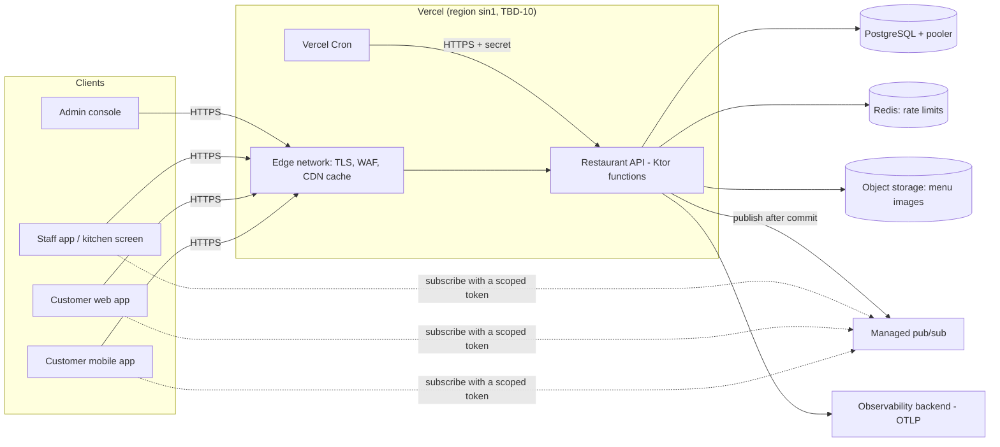
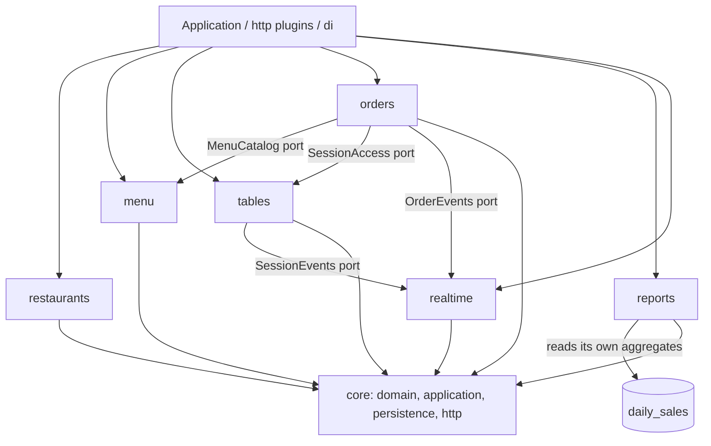

# Architecture: Restaurant ordering service

| Version | Status | Owner | Reviewers |
|---|---|---|---|
| 0.2 | Draft | Manh Nguyen (tech lead) | Senior backend dev TBD, client dev TBD, QA TBD, security TBD, operations TBD |

Baseline: [requirements.md](requirements.md) v1.1 (G1 2026-10-13; CR-002 2026-10-14). Decisions marked **Proposed** depend on the spikes in §17 and become Accepted, or change, before G2.

## 1. Drivers
Quality goals, ranked (ASSUMPTION-8, to confirm at G2):
1. **Tenant and table isolation.** A leak across restaurants would hurt every customer at once.
2. **Order integrity.** No lost, duplicated or mispriced order.
3. **Availability during service hours.** Lunch and dinner peaks are when the business makes its money.
4. **Live-update latency.** The kitchen sees an order within 2 s.
5. **Operability and cost for a small team** on a serverless platform.

| Quality goal (rank) | Scenario | Tactic | NFR / FR |
|---|---|---|---|
| 1. Isolation | A waiter of restaurant A sends restaurant B's order ID. B's order is neither revealed nor changed. | `restaurant_id` on every tenant row; every service method takes the `Caller` and scopes by its restaurant; PostgreSQL row-level security as a second line (ADR-0005); 404 for foreign IDs; authorisation-matrix tests | NFR-SEC-02, FR-042 |
| 1. Isolation | A guest copies a session token and tries another table's orders | The session token is bound to one session, table and restaurant; every guest query filters by the token's session (ADR-0006) | NFR-SEC-02, FR-005 |
| 2. Integrity | The guest's network drops after `POST` order and the app retries 3 times. Exactly one order exists. | `Idempotency-Key` row written in the same transaction as the order | NFR-REL-02, FR-003 |
| 2. Integrity | A manager raises a price while guests are ordering. Orders already placed keep their price; new ones use the new price. | Server-side pricing; price snapshot on each order line | FR-003, FR-007 |
| 2. Integrity | A function instance is killed right after the order commits but before the live notification is published. The kitchen still sees the order. | Transactional outbox; per-minute sweep; clients catch up from the event log (ADR-0003) | NFR-REL-02, NFR-REL-03 |
| 3. Availability | Dinner peak at 300 req/s with one instance crashing | Stateless functions on Vercel scale out per request; no in-memory state; database behind a pooler (ADR-0002, ADR-0004) | NFR-AVAIL-01/02, NFR-SCAL-01 |
| 3. Availability | One restaurant (or a prankster with its QR) floods the API. Other restaurants are unaffected. | Edge rate limits (Vercel WAF) per IP; application limits per session, staff user and restaurant in a shared store (ADR-0008) | NFR-SCAL-02, NFR-SEC-04 |
| 4. Latency | Order placed → kitchen screen at peak in ≤ 2 s p95 | After commit, publish a thin event to managed pub/sub; the client fetches the change from the event log (ADR-0003) | NFR-PERF-03 |
| 4. Latency | 5,000 guests open menus at 19:00 | Menu read is cacheable at the edge per restaurant and revalidated with `ETag` (short `s-maxage`); sold-out is enforced again at order time | NFR-PERF-01, FR-002 |
| 4. Latency | A manager opens a 31-day report | Daily aggregates per restaurant, written when a session closes and reconciled nightly | NFR-PERF-04, FR-050 |
| 5. Operability | A bad release at 18:55 | Vercel instant rollback to the previous deployment; expand-only migrations | NFR-OPS-01 |

Constraints: Kotlin + Ktor; Vercel (stakeholder-mandated); Vietnam PDP Law and Decree 13 (residency TBD-10); ASVS L2; no payments; team, budget and date TBD-9.

## 2. Context

Trust boundaries:
- internet → Vercel edge (TLS, WAF);
- edge → function (Vercel's network);
- function → database, Redis, object storage, pub/sub and observability. These are all third-party managed services reached over TLS with credentials, with no private network (risk R-06).
- Guests are anonymous and untrusted. Staff sign in to the service itself (email and password, ADR-0011) and are limited to their restaurant. Platform admins are a separate group that also needs an authenticator-app code (TOTP). No external identity provider.

## 3. Stack
The ktor-sdlc default stack applies, except for:

| Concern | Choice | ADR |
|---|---|---|
| Module layout | One Gradle module, packages by feature | ADR-0001 |
| Deployment platform | Vercel container runtime (an OCI image run as a Function, as in `ktor-sample`), region `sin1`; cold start and limits measured by spike S-1 | ADR-0002 (Proposed) |
| Live updates | Managed pub/sub for notifications + PostgreSQL event log for catch-up | ADR-0003 (Proposed) |
| Database hosting | Managed PostgreSQL in Singapore with a transaction-mode pooler; Hikari pool of up to 10 per instance (2 s wait, 5 s statement timeout); `prepareThreshold=0` | ADR-0004 (Proposed) |
| Tenant isolation | `restaurant_id` checks in services + PostgreSQL RLS via `SET LOCAL` | ADR-0005 |
| Guest authentication | Service-issued QR token and table-session token (ES256) | ADR-0006 |
| Staff and admin authentication | Built-in accounts: Argon2id password hashes, service-issued ES256 access tokens and rotating refresh tokens, TOTP for platform admins; no external identity provider | ADR-0011 (CR-002) |
| OpenAPI | Hand-written contract; responses validated against it in contract tests; no generation from code | ADR-0007 |
| Rate limiting | Vercel WAF + Redis counters (the in-memory Ktor RateLimit plugin can't share counters across serverless instances) | ADR-0008 (Proposed) |
| Metrics and tracing | Push over OTLP (Micrometer OTLP registry + OpenTelemetry Ktor instrumentation library), because there is no stable instance to scrape | ADR-0009 |
| Scheduled jobs | Vercel Cron calling internal job endpoints | ADR-0002 |

Toolchain (pinned in `gradle/libs.versions.toml` at the start of Phase 4, latest stable then): Kotlin 2.4.x · Ktor 3.6.x · JDK 25 (LTS) · Exposed latest stable · PostgreSQL 17 or newer, as the provider offers (S-2). Ktor's compiler plugin is only needed for OpenAPI generation, which ADR-0007 doesn't use.

## 4. Modules
Layout A from the skill: one Gradle module, packages by feature (ADR-0001).

| Package | Owns | Tables (Phase 3 finalises) |
|---|---|---|
| `restaurants` | Tenants, profile, settings, staff and roles, platform admin | `restaurants`, `staff_members` |
| `menu` | Categories, items, options, translations, images, sold-out | `menu_categories`, `menu_items`, `menu_item_options` |
| `tables` | Tables, QR keys, table sessions, waiter calls | `dining_tables`, `table_qr_keys`, `table_sessions`, `waiter_calls` |
| `orders` | Orders, lines, state machine, bills, payments recorded at the counter | `orders`, `order_lines`, `bills` |
| `reports` | Daily aggregates and report queries | `daily_sales` |
| `realtime` | Event log, outbox relay, pub/sub token issuing | `domain_events`, `outbox` |
| `core` | `Caller`, `DomainError`, `Transactor`, IDs, clock, idempotency, audit, rate-limit port, problem details, auth | `idempotency_keys`, `audit_events` |

Layer rules: the skill's hexagonal rules. Project additions:
- **Features don't read each other's tables.** Orders gets prices through a `MenuCatalog` port and session state through `SessionAccess`, both implemented in their owning feature.
- **Every repository method takes a `RestaurantId`** (ADR-0005).
- **No feature keeps in-memory state between requests**, because instances are serverless.

Shared `api-contract` KMP module with the clients: **not now**. It will be reconsidered when TBD-2 (mobile platforms) is decided. If the apps are KMP, it becomes a new ADR.

## 5. API
- **Style:** REST + JSON, base path `/v1`, per the skill's API design reference. Three route groups with separate authentication:
  - guest routes with a table-session token;
  - staff routes with a staff access token (`aud` = `staff`);
  - admin routes with an admin access token (`aud` = `admin`, `amr` contains `otp`) and the platform-admin flag in the database.

  Sign-in routes (`/v1/auth/*`: sign-in, TOTP step, refresh, sign-out, accept invitation, reset password) need no token and have their own rate limits (§7).

  Internal job routes (`/internal/jobs/*`) need the cron secret and are not in the public contract.
- **Contract:** `docs/api/openapi.yaml`, hand-written in Phase 3 and frozen at G3. CI runs `oasdiff breaking` against the previous release's contract, and contract tests validate every route-test response against the schema (ADR-0007).
- **Versioning and deprecation:** major version in the path. Additive changes only within `/v1`. A breaking change means `/v2`, plus `Deprecation`/`Sunset` headers on `/v1` for at least the mobile support window (TBD-3, proposed 12 months). Usage per version and per client version is tracked from the `User-Agent`/`X-Client-Version` header in metrics.
- **Oldest supported client versions:** mobile 1.0.0 at launch; web and staff apps always latest. The service can return `426`-style `client_upgrade_required` problem details below a configured minimum mobile version, as a forced-update lever.
- **Money:** `{"amount": "125000", "currency": "VND"}` (VND has no minor unit), stored as `BIGINT` đồng.
- **Error-code catalogue:** a section in the OpenAPI contract (Phase 3), e.g. `table_session_closed`, `item_unavailable`, `order_not_cancellable`, `qr_token_invalid`, `restaurant_suspended`.

## 6. Data stores
| Store | Holds | Why this store | Size and growth | Consistency | Backup and retention |
|---|---|---|---|---|---|
| PostgreSQL (managed, Singapore; ADR-0004) | All business data, staff credentials (password hashes, encrypted TOTP secrets, refresh-token and link-token hashes), the event log, outbox, idempotency keys, audit log | Transactions across order, idempotency key, event and outbox; relational reporting | ≈ 100k orders and 300k lines per day at 500 restaurants (ASSUMPTION-9) → ≈ 50 GB/year including indexes; event log ≈ 500k rows/day, kept 7 days | Strong, single primary; reads from the primary (no replicas until measured) | PITR ≥ 7 days (RPO ≤ 5 min); daily snapshot copied to a second region/account; quarterly restore drill (NFR-REL-01) |
| Redis (managed, serverless, same region; ADR-0008) | Rate-limit counters only | Atomic counters with TTL shared by all instances; keeps that churn off PostgreSQL | < 100 MB | Best effort. If Redis is down, app-level limits fail open and WAF limits still apply | None needed (ephemeral) |
| Object storage (e.g. Vercel Blob; FR-022) | Menu images | Large binaries off the database; served by CDN | ≈ 1,000 items × 500 restaurants × ≤ 500 KB (after resize) ≈ 250 GB worst case | Write-once objects under generated names | Versioning on; deleted with the item after 30 days |
| Managed pub/sub (ADR-0003) | Nothing durable: thin "something changed" notifications | Fan-out to ≈ 17,500 live clients, which Vercel functions can't hold open | — | At most once; the event log is the source of truth | None |

- **Migrations:** Flyway SQL in `db/migration/`, expand → migrate → contract. CI runs them as a step **before** promoting a deployment, with a separate DDL user, never from inside a function.
- **Retention jobs** (Vercel Cron, ADR-0002):
  - event log > 7 days, idempotency keys > 24 h and outbox rows sent > 7 days are purged;
  - item notes are cleared 30 days after the session closes;
  - device data on sessions is removed after 90 days;
  - staff are anonymised 30 days after deactivation;
  - the order and bill retention depends on TBD-4.

## 7. Authentication and authorisation
**Staff and admins** (built-in accounts, ADR-0011, CR-002). No external identity provider: the service stores the credentials and issues the tokens.

- **Passwords.** Argon2id, OWASP parameters (19 MiB memory, 2 iterations, parallelism 1), 16-byte random salt, stored as a PHC string (`$argon2id$v=19$m=19456,t=2,p=1$…`), so the parameters can be raised later and old hashes upgraded at the next sign-in. Rules (ASVS 5.0 V6.2): 8–64 characters, every character allowed, no composition rules, rejected if it is on a bundled list of common passwords. Bouncy Castle (`bcprov-jdk18on`) does the hashing, chosen after S-4 (≈ 2× faster than Password4j on a Vercel instance: p95 85 vs 130 ms); no custom cryptography. At most 4 hashes run at once per instance (a semaphore), so a burst can't exhaust the function's memory.
- **Sign-in** `POST /v1/auth/sign-in` with email and password:
  - unknown email and wrong password give the same `401 invalid_credentials`, and an unknown email still runs Argon2id against a dummy hash, so response time doesn't reveal which emails exist;
  - a deactivated account gets the same 401;
  - a platform admin gets `200 {"mfa_required": true, "mfa_token": …}` instead of tokens. The `mfa_token` is single-use and lives 5 min. `POST /v1/auth/mfa` with it and a 6-digit TOTP code returns the tokens.
- **TOTP for admins** (RFC 6238: HMAC-SHA1, 6 digits, 30 s step, ±1 step accepted). The 160-bit secret is encrypted with AES-256-GCM under a key from Vercel sensitive environment variables. A code's time step can't be used twice (the last used step is stored). Enrolment happens on the admin's first sign-in through an invitation. A lost authenticator is reset by another platform admin, or for the last admin by a one-off command run by the operator; both are audited.
- **Access token.** ES256 JWT, lifetime 15 min (ASSUMPTION-5). Claims: `iss` (the service URL), `aud` (`staff` or `admin`), `sub` (staff member ID), `sid` (the refresh-token family), `amr` (`["pwd"]`, or `["pwd","otp"]` after TOTP), `iat`, `exp`, and `kid` in the header. The API checks the signature with the staff key set, the algorithm (ES256 only), `iss`, `aud` and `exp` with a 30 s leeway. Admin routes also require `otp` in `amr`. Staff tokens use their own signing keys, separate from the guest keys in ADR-0006; both sets live in Vercel sensitive environment variables and rotate with overlap (the current and previous public keys verify).
- **Who the caller is.** Restaurant, role, active flag and platform-admin flag are **read from `staff_members` on every call**, not from token claims, so a deactivation or role change takes effect on the next call.
- **Refresh token.** 256-bit random, stored as a SHA-256 hash with its family ID, lifetime 12 h (one shift). Every refresh (`POST /v1/auth/refresh`) returns a new refresh token and invalidates the old one. If a used refresh token comes back, the whole family is revoked (it was probably stolen) and the event is audited. Sign-out, a password change, a role change and deactivation revoke the member's families.
- **Where clients keep tokens.**
  - Staff web app: the access token in memory only; the refresh token in an `HttpOnly; Secure; SameSite=Strict` cookie with `Path=/v1/auth`. The staff app and the API must be on the same site (e.g. `staff.<domain>` and `api.<domain>`) for the cookie to be sent; a strict CSP applies.
  - Mobile apps (if the staff app ships to stores, TBD-2): the refresh token in the response body, kept in Android Keystore or iOS Keychain.
- **Invitations and password resets** (FR-040, FR-041). The inviter (admin or manager) gets a one-time link and passes it on themselves; release 1 sends no email. The token is 256-bit random, stored as a SHA-256 hash, single-use: 72 h for an invitation, 24 h for a reset. The link puts the token in the URL fragment (`https://staff.<domain>/invite#<token>`) so it never reaches server logs or `Referer` headers. Opening it lets the person set a password (and, for an admin, enrol TOTP). Issuing a new link for the same person invalidates the old one. Who may issue a reset: a manager for their own staff, a platform admin for a manager, another platform admin for an admin.
- **Brute force and credential stuffing** (ASVS 5.0 V6.3).
  - Per account, in PostgreSQL (so it holds even when Redis is down): after 10 failed sign-ins or TOTP codes in 15 min, the account is locked for 15 min; the next success resets the count. The lock gives the same 401, so it doesn't reveal that the account exists.
  - Per IP, in Redis and the WAF (ADR-0008): sign-in, TOTP, refresh and link acceptance.
  - Every sign-in, failure, lock, MFA step, refresh-token reuse, invitation and reset is written to the audit log (NFR-SEC-03).

**Guests** (ADR-0006).
- **QR code.** The QR encodes `https://<app-domain>/t/<qrToken>`. The `qrToken` is a signed, compact token: restaurant ID, table ID, key ID, ES256 signature over a per-table key version. Rotation bumps the table's key version, so old codes fail at once.
- **Table session.** Presenting a valid QR token opens or joins the table's open session. The response is a **table-session token**: ES256 JWT, `sub` = device ID, claims for session, table and restaurant, lifetime 6 h. Every guest call also checks in the database that the session is still open, so closing a session revokes all its tokens at once.
- **Web app.** The customer web app keeps the session token in memory and `sessionStorage` (low value, scoped to one visit), with a strict CSP. The staff web app's token handling is described under staff and admins above.

**Service-to-service.**
- Vercel Cron → API: `Authorization: Bearer <CRON_SECRET>` on `/internal/jobs/*`.
- API → pub/sub, Redis, database, object storage: per-environment credentials from Vercel encrypted environment variables.
- Pub/sub client tokens are minted by the API with **subscribe-only** rights on exactly one channel.

**Authorisation matrix** (operations; Phase 3 maps them to endpoints). Scope: "own" = the caller's restaurant; "session" = the guest's session. Anything outside scope → 404.

| Resource / operation | Guest (session) | Kitchen | Waiter | Manager | Platform admin | Object-level rule |
|---|---|---|---|---|---|---|
| Open / join table session from QR | Yes | — | — | — | — | Valid QR key version; table enabled; restaurant active |
| Read menu | Own restaurant | Own | Own | Own | Any | Restaurant of the token / caller |
| Edit menu (items, categories, options, images) | No | No | No | Own | No | `restaurant_id` match |
| Toggle sold out | No | Own | No | Own | No | `restaurant_id` match |
| Place order | Own session | No | Own (FR-014) | Own (FR-014) | No | Session open; items of the same restaurant |
| Cancel order in `placed` | Own session | No | Own | Own | No | Status `placed` (guest); staff per FR-012 |
| Read orders / bill / status | Own session | Own | Own | Own | No | Guest: `session_id` match; staff: `restaurant_id` |
| Change order status / reject line | No | Own | Own (`served`, reject) | Own | No | Allowed transitions per role (Phase 3) |
| Call waiter / request bill | Own session | No | Read and ack, own | Read and ack, own | No | |
| Manage tables, QR rotation | No | No | No | Own | No | |
| Open / move / close session; record payment | No | No | Own | Own | No | Target table free (move) |
| Live-update subscription token | Own session channel | Own restaurant channel | Own restaurant channel | Own restaurant channel | No | Channel derived on the server, never from client input |
| Staff management | No | No | No | Own (not last manager) | Any (first manager) | |
| Restaurant profile and settings | No | Read own | Read own | Own | Any | |
| Reports | No | No | No | Own | No (TBD) | |
| Onboard / suspend restaurant | No | No | No | No | Yes | |
| Audit log read | No | No | No | Own (TBD) | Any | |

## 8. Deployment topology (ADR-0002, Proposed)
- **Platform:** Vercel, one project for the API. Function region `sin1` (Singapore), the nearest to Vietnam. **TBD-10** decides whether that region is legally acceptable; Vercel has no region in Vietnam.
- **Runtime:** the Ktor app as a JDK 25 OCI image on Vercel's container runtime (`vercel.json` service, `"runtime": "container"`), the same model as the stakeholder's `ktor-sample`.
  - Instances scale to zero after 5 min idle (30 s in preview) and get `SIGTERM` with 30 s of grace.
  - `PORT=8080`, and the entrypoint rebuilds `PATH`.
  - No static IPs or Secure Compute for containers (R-06).
  - Spike S-1 measures cold start (plain and with a JDK AOT cache), concurrency per instance, the maximum duration, SSE streaming, and CPU and memory per instance.
- **Environments:**

  | Environment | Vercel | Database | Pub/sub, Redis | Purpose |
  |---|---|---|---|---|
  | dev | `vercel dev` / local JVM | Local PostgreSQL (Docker) | Local fakes | Development |
  | preview | A deployment per PR | A database branch per PR, where the provider supports it; otherwise a shared preview database | Dev tenant | Review, smoke tests |
  | staging | Staging environment (custom env or a protected branch) | Staging database, production-sized for load tests | Staging tenant | System, NFR, acceptance |
  | production | Production | Production database (HA) | Production tenant | Live |

  Environments differ only in environment variables and sizes.
- **Edge:**
  - TLS terminated by Vercel, HSTS on;
  - Vercel WAF with managed rules and rate-limit rules per IP and path (ADR-0008);
  - CDN caching only for the public menu read and images;
  - `X-Forwarded-For` trusted only as set by Vercel (S-1 confirms the header).
- **Health:** `/health/live` and `/health/ready` for the smoke tests and the uptime monitor. Vercel has no liveness probes; failed instances are replaced per request.
- **Rollout:**
  - Every merge to `main` builds a preview deployment.
  - Promotion to production happens after the CI gates and migrations.
  - Gradual traffic shift with Vercel Rolling Releases if the plan provides it (S-1); otherwise all at once, behind feature flags.
- **Rollback:** Vercel instant rollback to the previous production deployment (≤ 10 min, NFR-OPS-01). Migrations are expand-only within a release, so the previous deployment still works.

## 9. Capacity model
Peak = dinner peak at launch (ASSUMPTION-1, confirmed at G1). Load mix (ASSUMPTION-9, calibrated by S-1 and the pilot):

| Endpoint group | Peak req/s | Origin req/s (after CDN) | Queries per request | Notes |
|---|---|---|---|---|
| Menu read (guest) | 70 | ≤ 15 | 3 | Public per restaurant, `s-maxage` ≈ 30 s + `ETag` |
| Session, orders, bill (guest) | 70 | 70 | 2–3 | Indexed by `session_id` |
| Event catch-up (guest + staff) | 75 | 75 | 1 | `restaurant_id, seq` index; tiny pages |
| QR open/join session | 15 | 15 | 3 (1 write) | Rate-limited |
| Place order | 10 | 10 | ≈ 6 (write transaction) | ≈ 600 orders/min system-wide |
| Order status changes | 40 | 40 | 4 (write) | ≈ 4 transitions per order |
| Staff lists, tables overview | 15 | 15 | 2 | |
| Pub/sub token | 10 | 10 | 1 | Cached by clients until expiry |
| Admin, reports, menu edits | 5 | 5 | 2–5 | Reports read `daily_sales` |
| **Total** | **≈ 310** | **≈ 255** | | ≈ 800 queries/s, ≈ 60 write transactions/s |

- **In flight:** at ≈ 50 ms average service time, ≈ 15 requests are in flight at peak, 45 at 3× growth.
- **Bottleneck: PostgreSQL connections, not CPU.** Every serverless instance holds its own pool, so instance count × pool size can exceed the database's limit during scale-out bursts. The tactic (ADR-0004):
  - a transaction-mode pooler in front of PostgreSQL;
  - Hikari `maximumPoolSize` 10 per instance, opened on demand (`minimumIdle` 1), 2 s connection wait; with 3, requests queued in S-2 because Vercel sends many concurrent requests to one instance;
  - pooler server-side pool ≈ 40 connections;
  - short transactions with no remote calls inside.
- **Database size:** 2 vCPU / 8 GB with HA standby at launch (to validate with S-2 and the load test). 3× growth fits with a larger instance; no read replicas before measurements show a need.
- **Pub/sub:** ≈ 17,500 concurrent connections and ≈ 300 messages/s at launch, ≈ 52,500 at 3×. The provider and plan are chosen in S-3.
- **Headroom:** the load test must pass at 2× peak (≈ 600 req/s) without breaching NFR-PERF.
- **Cost estimate:** TBD-11, draft in [cost-estimate.md](cost-estimate.md): ≈ $1,540–1,740 a month at launch without menu images (≈ $3–3.50 per restaurant), ≈ $3,700–4,350 at 3×. The pub/sub figure is a placeholder until S-3. The cost drivers, largest first:
  - pub/sub connections and messages (≈ 55–60%);
  - Vercel per-request charges: CDN requests, invocations, origin transfer;
  - menu images, if FR-022 is a Must (TBD-5);
  - database compute and storage.

## 10. Reliability
| Dependency | Timeout | Retries | Circuit breaker | If it fails |
|---|---|---|---|---|
| PostgreSQL (via pooler) | Pool wait 2 s; query timeout 3 s (reports 10 s); `statement_timeout` 5 s for the app user | None | — | 503 `service_unavailable` with `Retry-After`; no orders accepted (NFR-AVAIL budget) |
| Redis (rate limits) | 100 ms | None | Yes (open after repeated timeouts) | Fail open for app-level limits; WAF limits still apply; alert |
| Pub/sub publish | 1 s | 2 with backoff (idempotent: event ID) | Yes | Event stays in the outbox; cron sweep republishes; clients still catch up by polling (NFR-REL-03) |
| Object storage | 5 s upload | None (client retries with `Idempotency-Key`) | — | Upload 503; menus show without images |

- **Idempotency:** `Idempotency-Key` required on order placement, session open/join, waiter calls, staff-placed orders, session close and restaurant onboarding. Stored 24 h, in the same transaction as the change.
- **Optimistic locking:** `version` column, `ETag`/`If-Match` on orders, menu items, tables, sessions and restaurant profile.
- **Event log and outbox** (ADR-0003):
  - Each state change writes a `domain_events` row in the same transaction.
  - Its `seq` comes from a per-restaurant counter (`UPDATE restaurants SET event_seq = event_seq + 1 RETURNING event_seq`). Commit order then equals sequence order within a restaurant, so a client cursor never skips a late-committing event.
  - An `outbox` row is written with it. After commit, the request publishes it (best effort), and the per-minute cron sweep publishes the rest.
- **Scheduled jobs:** Vercel Cron → `/internal/jobs/<name>`. Each job:
  - is idempotent;
  - processes bounded batches within the function's maximum duration;
  - holds `pg_try_advisory_xact_lock` (transaction-scoped, which is safe with transaction pooling) so only one run works at a time.

  Jobs: outbox sweep (1 min), daily-sales reconciliation (nightly), retention and anonymisation (daily), event-log and idempotency purge (hourly).
- **Graceful degradation:**
  - Live updates down → clients poll the catch-up endpoint (interval chosen in Phase 3).
  - Redis down → WAF only.
  - Images down → menu without images.

## 11. Cross-cutting concerns
| Concern | Decision |
|---|---|
| Configuration and secrets | `application.yaml` with env substitution → one `AppConfig`. Secrets are Vercel environment variables of the *sensitive* type, per environment, never in Git. Rotation: database, Redis, pub/sub and cron secrets rotated every 6 months and on staff change; rotation = update the variable + redeploy. Signing keys for QR and session tokens carry a `kid`, so old and new keys overlap during rotation |
| DI | Koin. `appModule(config)` + one module per feature |
| Error model | Sealed `DomainError` → problem+json via StatusPages; stable `code`s in the contract's catalogue |
| Logging | JSON (logstash encoder) to stdout → Vercel logs → log drain to the observability backend. `call_id`, `restaurant_id` (pseudonymous ID) and deployment ID in the MDC. Masking of `Authorization`, QR and session tokens. No names, emails, phones, notes or IPs in application logs (IPs only in edge logs, 30 days) |
| Audit log | `audit_events` table: append-only (no UPDATE/DELETE grant for the app user), hash-chained per restaurant for tamper evidence, exported nightly to object storage with retention lock (TBD-4) |
| Feature flags | Per-restaurant settings in the database (e.g. FR-016 waiter confirmation). Global kill switches in a `feature_flags` table, cached ≤ 30 s per instance |
| Time, IDs, money | UTC `Instant` on the wire and in the database; reports by the restaurant's IANA time zone. UUID v7 IDs. Money as `BIGINT` VND, wire `{"amount","currency"}` |
| i18n | Error `code`s localised by clients; menu translations vi/en (FR-024); no server-rendered text except CSV export headers |
| HTTP hardening | RequestBodyLimit (64 KB JSON; images go via a direct upload URL), DefaultHeaders, HSTS, `Cache-Control: no-store` on guest/staff data, CORS allow-list for the two web apps' origins, Compression, ConditionalHeaders |

## 12. Security
Level: ASVS 5.0 L2. Assets:
- staff personal data and credentials (password hashes, TOTP secrets, refresh tokens, invitation and reset links);
- order, bill and sales records (financial);
- token signing keys (guest and staff) and session tokens;
- tenant isolation;
- availability during service hours;
- the audit log;
- cloud credentials and the CI/CD pipeline.

| Asset / entry point | Threat (STRIDE / API Top 10) | Mitigation | ASVS 5.0 chapter | Req ID |
|---|---|---|---|---|
| Guest routes: QR open/join | Spoofing: forged or guessed QR token; replay of a rotated code | ES256 signature with `kid`; per-table key version; rate limit per IP and table | V9 Self-contained Tokens, V2 Validation and Business Logic | FR-001, FR-031, NFR-SEC-04 |
| Guest routes: QR open/join | Abuse of a photographed QR away from the table (API6) | Rotation; per-session order rate limits; staff cancel; optional waiter confirmation (FR-016) | V2 Validation and Business Logic | R-02, FR-016 |
| Guest routes: orders, bill | Information disclosure: another table's orders (API1) | Session ID from the token only; every query filters by `session_id`; foreign IDs → 404 | V8 Authorization | FR-005, NFR-SEC-02 |
| Guest routes: orders | Tampering: client-supplied prices, quantities, items of another restaurant (API3) | Request DTOs carry item IDs and quantities only; server prices; items must belong to the session's restaurant | V2, V15 Secure Coding and Architecture | FR-003 |
| Staff routes | Information disclosure / tampering across restaurants (API1) | `Caller.restaurantId` from the database; repository methods take `RestaurantId`; RLS with `SET LOCAL app.restaurant_id` | V8 Authorization | FR-042, NFR-SEC-02 |
| Staff routes | Elevation of privilege: kitchen edits the menu; manager edits staff of another restaurant (API5) | Role checks in services per the matrix; tests per role | V8 Authorization | FR-010, FR-041 |
| Staff and admin tokens | Spoofing with forged, expired or foreign tokens (API2) | ES256 only, signature against the staff key set, `iss`, `aud` (`staff`/`admin`), `exp`; admin routes need `otp` in `amr`; staff keys separate from guest keys | V9 Self-contained Tokens, V6 Authentication | FR-010, NFR-SEC-04 |
| Sign-in, TOTP step | Credential stuffing and password guessing (API2); account enumeration | Per-account lock in PostgreSQL (10 failures / 15 min); per-IP limits in Redis and WAF; common-password list; same 401 and dummy hash for unknown emails; audit | V6 Authentication | FR-010, NFR-SEC-04 |
| Stored credentials | Information disclosure: a database leak exposes passwords or TOTP secrets | Argon2id (19 MiB, t=2); TOTP secrets AES-256-GCM encrypted with a key outside the database; refresh and link tokens stored as SHA-256 hashes | V6, V11 Cryptography | NFR-SEC-01 |
| Refresh tokens | Session theft and replay | `HttpOnly; Secure; SameSite=Strict` cookie scoped to `/v1/auth`; rotation on every use; reuse revokes the family; 12 h lifetime; revoked on sign-out, password or role change and deactivation | V7 Session Management | FR-010 |
| Invitation and reset links | A leaked link lets someone else take the account | 256-bit single-use token, hashed at rest; 72 h (invite) / 24 h (reset); token in the URL fragment; a new link voids the old; audit | V6 Authentication | FR-040, FR-041 |
| Admin routes | Elevation of privilege; brute force | Separate route group; TOTP at every sign-in; audit of every action; IP allow-list optional | V8, V6, V16 Security Logging | FR-040, NFR-SEC-03 |
| Pub/sub channels | Information disclosure: subscribing to another restaurant's channel | Channel names derived on the server; subscribe-only tokens per channel; payloads carry IDs and versions only, no personal data | V8, V14 Data Protection | FR-005, FR-011, NFR-PRIV-01 |
| Internal job routes | Spoofing: anyone calling `/internal/jobs/*` | Cron secret, compared in constant time; jobs idempotent and locked | V13 Configuration, V11 Cryptography | NFR-SEC-01 |
| Menu image upload | Malicious file, oversized upload (API4) | Size limit; magic-byte check; re-encode/resize; generated names; served from the storage/CDN domain, never the API domain | V5 File Handling | FR-022 |
| All routes | Denial of service, resource consumption (API4) | WAF rate rules; app rate limits per session, staff and restaurant; body size limits; page-size caps; query timeouts | V4 API and Web Service, V2 | NFR-SCAL-02, NFR-SEC-04 |
| All routes | Misconfiguration (API8): debug mode, stack traces, CORS `*` | No development mode in production; StatusPages hides internals; CORS allow-list; security headers; DAST in Phase 5 | V13 Configuration, V3 Web Frontend Security | NFR-SEC-01 |
| Endpoint inventory (API9) | Undocumented or forgotten routes | Contract is the inventory; route-listing test vs contract; `/internal` excluded from the edge for anything except Cron | V4 | NFR-COMPAT-01 |
| Third-party services (API10) | Unsafe consumption: pub/sub and storage responses | Timeouts; validated, size-limited responses; errors mapped | V4, V15 | NFR-REL-02 |
| Database | Tampering / repudiation: altered bills or audit | App user has no DDL; no UPDATE/DELETE on `audit_events`; closed bills immutable; hash-chained audit | V16 Security Logging, V14 | NFR-SEC-03, FR-013 |
| Secrets and CI/CD | Leaked credentials; malicious dependency | Sensitive env vars; secret scanning in CI; dependency and image/bundle scanning; protected `main`; production promotion only from CI; SBOM | V13, V15 | NFR-SEC-01 |
| Personal data | Over-collection; data kept too long; data outside the agreed region | Data inventory; retention jobs; logs without PII; regions per TBD-10 | V14 Data Protection | NFR-PRIV-01/02 |

## 13. Observability and operations
- **SLOs and burn-rate alerts:**
  - availability 99.9% / 28 days (NFR-AVAIL-01);
  - order flow 99.9% (NFR-AVAIL-02), measured as placement success plus event-log publish delay ≤ 2 s;
  - guest-read latency (NFR-PERF-01).

  Alerts fire on fast (1 h at 14×) and slow (6 h at 6×) burn rates. Every alert links to a runbook.
- **Metrics** pushed over OTLP (ADR-0009):
  - RED per route;
  - pool usage and wait;
  - pub/sub publish failures, outbox backlog and age;
  - cold starts;
  - business: orders placed, sessions open, feed delay.
- **Tracing:** OpenTelemetry Ktor instrumentation library + JDBC instrumentation. Sampling: 10% normal, 100% on errors. Request ID returned as `X-Request-ID`.
- **Dashboards:** service overview, order flow (placement → event → publish delay), database, per-restaurant traffic (top 10), and deploy markers from Vercel.
- **On-call owner and escalation:** TBD (ops owner not named; R-07).
- **Runbooks to write before launch:**
  - SLO burn;
  - database saturation or failover;
  - pub/sub outage (clients on polling);
  - outbox backlog;
  - noisy tenant / abuse;
  - QR leak (mass rotation);
  - bad deploy → instant rollback;
  - restore from backup;
  - secret rotation;
  - suspending a restaurant.
- **DR tier: backup and restore.**
  - RPO ≤ 5 min via PITR; RTO ≤ 1 h: restore to a new database, update the connection variables, redeploy.
  - The provider's HA standby covers zone failure.
  - A Vercel region outage is covered by redeploying to a fallback region, subject to TBD-10.

## 14. Build, CI/CD and release
- **CI (GitHub Actions; repository host TBD):**
  1. build;
  2. ktlint and detekt;
  3. unit tests;
  4. integration tests with Testcontainers PostgreSQL;
  5. contract tests and `oasdiff breaking`;
  6. Kover coverage gate;
  7. dependency scan;
  8. secret scan;
  9. bundle build for Vercel;
  10. migration rehearsal on a database branch;
  11. deploy to preview;
  12. smoke tests.
- **Release:**
  1. Merge to `main`.
  2. Flyway migrations run on staging, then a staging deployment, smoke tests and the acceptance subset.
  3. A manual approval (tech lead), then Flyway on production and promotion of the **same build output** to production.
- **Build artefact:** produced once per commit and promoted (the platform equivalent of "promote by digest"); SBOM attached.
- **Infrastructure as code:** Vercel project settings, environment variables (names, not values), WAF rules and cron in `vercel.json` or Terraform (Vercel provider). Database, Redis and pub/sub via Terraform where providers exist.
- **Who can deploy to production:** only the CI pipeline, after approval. Vercel team members with production access are listed in the access review.

## 15. Test strategy
Full detail in [test-plan.md](test-plan.md).
- **Unit:** services and domain with fakes.
- **Integration:** `testApplication` + Testcontainers PostgreSQL, including RLS, the event sequence, idempotency and the authorisation matrix.
- **Contract:** schema validation + `oasdiff`.
- **System, NFR and acceptance:** on staging, with k6 load including simulated pub/sub subscribers, resilience (pub/sub and Redis outages, instance kills) and ZAP.

## 16. Risks and technical debt
| ID | Risk or debt | Impact | Mitigation | Owner |
|---|---|---|---|---|
| R-01 | Vercel runtime limits for a JVM Ktor app (cold starts after scale-to-zero, duration, streaming) | NFR-PERF p99, NFR-OPS | Spike S-1; AOT cache or native image; CR to change platform if S-1 fails | Manh Nguyen |
| R-06 | No private network between the functions and the managed services | Wider attack surface for credentials | TLS everywhere; IP allow-lists where providers support them; least-privilege users; rotation | Manh Nguyen |
| R-08 | Dependence on a pub/sub vendor | Cost, vendor outage | Thin events; polling fallback built in; vendor behind a `RealtimePublisher` port | Manh Nguyen |
| R-09 | Connection bursts from many serverless instances | Database saturation at scale-out | Pooler; pool up to 10 per instance, 2 s wait, 5 s statement timeout; Vercel concurrency settings; load test at 2× peak | Manh Nguyen |
| D-01 | Hand-written OpenAPI contract can drift from the code | Contract errors | Response validation in contract tests; route-listing test (ADR-0007) | Manh Nguyen |

## 17. Proofs of concept (to run before G2)
| Spike | Question | Exit criterion | Feeds |
|---|---|---|---|
| S-1 Ktor on Vercel (`spikes/s1-vercel/`) | On the container runtime, measure cold start p50/p99 (plain and with the AOT cache), warm latency, concurrency per instance, maximum duration, SSE streaming, CPU and memory, proxy headers, and SIGTERM timing; check Rolling Releases and WAF availability | Warm p95 ≤ 50 ms for a trivial DB-free route; cold start small enough that p99 targets hold at the expected cold-start rate | ADR-0002 |
| S-2 PostgreSQL through the pooler | pgjdbc + Hikari via transaction pooling (`prepareThreshold=0`), `SET LOCAL` RLS, advisory xact locks, Flyway from CI, latency from `sin1` | Order-placement transaction p95 ≤ 40 ms from a Vercel function | ADR-0004, ADR-0005 |
| S-3 Live updates | Provider choice; end-to-end delay with 1,000–5,000 simulated subscribers; token scoping per channel; cost at 17,500 and 52,500 connections | p95 ≤ 1 s publish → receive; per-channel isolation verified | ADR-0003 |
| S-4 Built-in sign-in (`spikes/s4-auth/`) | Argon2id time and memory at the §7 parameters on a Vercel function in `sin1` (cold and warm, 1 and 4 at once); library choice for Argon2id, JWT and TOTP; token checks | Warm sign-in p95 ≤ 500 ms; valid, expired, forged, wrong-algorithm, wrong-audience tokens and an admin token without `otp` behave as specified | §7, ADR-0011 |
| S-5 Report query | `daily_sales` aggregation and a 31-day report on ≈ 1 year of synthetic data for one large restaurant | NFR-PERF-04 met | §9 |
