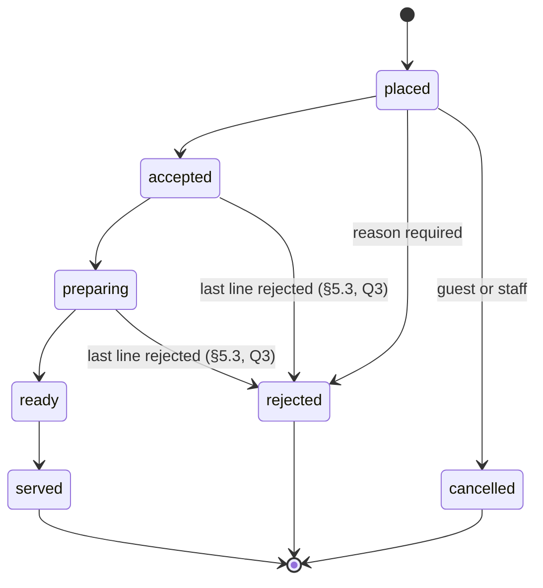

# Feature design: orders

| Field | Value |
|---|---|
| Version | 1.1 (CR-009, approved 2026-10-17: aligned with the Phase 4 build). 1.0 Approved at G3 on 2026-10-15 (baseline; changes need a CR). Last draft 0.3 (0.3: `SalesLedger` signatures and the lock order from [reports](reports.md) §11): the seven §15 questions decided by the owner on 2026-10-15 |
| Date | 2026-10-15 |
| Package | `orders` (architecture §4) |
| Requirements | FR-003 place, FR-004 more rounds, FR-005 guest status (reads; live delivery in `realtime`), FR-006 guest cancel, FR-007 bill, FR-011 staff feed (list fallback; live delivery in `realtime`), FR-012 state machine, FR-013 close and payment, FR-014 staff orders (Should), FR-015 line rejection (Should), FR-016 waiter confirmation (Could, TBD-8); FR-042, NFR-PERF-02, NFR-REL-02, NFR-SEC-02, NFR-SEC-03, NFR-SEC-04, NFR-PRIV-01 |
| Builds on | architecture.md v1.2 §4, §7, §9, §10; ADR-0003 (event log and outbox), ADR-0005; S-2 (order transaction), S-5 (bill close updates the daily aggregates); [core-and-auth](core-and-auth.md) 0.6; [restaurants](restaurants.md) 0.2; [menu](menu.md) 0.2 §7 `MenuCatalog`; [tables](tables.md) 0.2 §7 `SessionAccess` |
| Change request | [CR-006](../cr/CR-006-record-orders-decisions.md), approved 2026-10-15: writes TBD-7 and TBD-8 into the requirements and corrects architecture §6 and §9 |
| Owner decisions | §15, all seven accepted 2026-10-15 (TBD-7 and TBD-8 resolved) |

## 1. Scope
**In:**
- Placing orders: by guests (FR-003, FR-004) and by staff for a table (FR-014).
- Reading orders and the running bill: guests (their session) and staff (their restaurant).
- The order state machine and who may make each step (FR-012); guest cancel (FR-006); rejecting one line (FR-015).
- Closing a session with the payment recorded at the counter (FR-013), and corrections to a closed bill (TBD-7, §15 Q2).
- The ports `SessionSummaries` and `EmptyBills` that `tables` uses, and the calls `orders` makes to `menu`, `tables`, `realtime` and `reports`.

**Out:**
- How events reach screens, the catch-up endpoint and the polling interval (`realtime`). This design names the events and writes them (§9).
- The daily aggregate tables and the report query (`reports`). This design calls the `SalesLedger` port when a bill closes or is corrected (§7.3).
- FR-016 waiter confirmation, if the owner agrees it stays out of release 1 (§15 Q1).

## 2. The order's life
**In plain words:** an order is one "round" a table sends to the kitchen. It moves forward one step at a time, and each step is made by the people whose job it is. An order that's finished (served, rejected or cancelled) never changes again.



**Who may make each step** (FR-012 and architecture §7's matrix: kitchen "own", waiter "`served`, reject", manager "own"):

| To | From | Guest (own session) | Kitchen | Waiter | Manager |
|---|---|---|---|---|---|
| `accepted` | `placed` | — | Yes | — | Yes |
| `preparing` | `accepted` | — | Yes | — | Yes |
| `ready` | `preparing` | — | Yes | — | Yes |
| `served` | `ready` | — | Yes | Yes | Yes |
| `rejected` (reason) | `placed` | — | Yes | Yes | Yes |
| `cancelled` | `placed` | Yes (§5.2) | — | Yes | Yes |
| Reject one line (reason) | order `accepted` or `preparing` | — | Yes | — | Yes |

- **Any other step → `409 invalid_transition`.** Steps can't be skipped: FR-012 lists exactly these, so "accepted → ready" is two calls.
- **The role check looks only at the target status**, not at the order, so a 403 can't reveal whether an order exists (core-and-auth §3).
- **When a session is closed with unfinished orders** (FR-013 with `force`, §7.1), those orders become `cancelled` with reason `closed_with_session`. That's the close's own step, not one a role makes.
- **Clients must accept status values they don't know** (shown as "in progress"). The contract says so on the `status` field. That keeps FR-016's `pending_confirmation` an additive change within `/v1` if it's built later (§15 Q1).

## 3. Placing an order
### 3.1 Guest: `POST /v1/guest/orders` + `Idempotency-Key`
```json
{
  "lines": [
    { "item_id": "0192...", "quantity": 2, "option_ids": ["0192...", "0192..."], "note": "ít cay" },
    { "item_id": "0192...", "quantity": 1 }
  ]
}
```

**Validation** (400 `validation_failed`, every problem listed with its JSON Pointer):
- 1–50 lines (ASSUMPTION-4); `quantity` 1–20; `note` ≤ 200 characters; `option_ids` ≤ 50 per line, no duplicates.
- The client sends no prices. If it sends any, they're ignored like every unknown field (core-and-auth §2): the server prices the order (FR-003).

**Steps, in one transaction for the caller's restaurant:**
1. Rate limits (§10), before the transaction.
2. Idempotency key (core-and-auth §4): a replay returns the stored `201`; the same key with another body → `422 idempotency_key_reused`.
3. `SessionAccess.requireOpenForUpdate`: locks the session row `FOR SHARE`. Closed meanwhile → `409 session_not_open` (FR-003). A close takes the same row `FOR UPDATE`, so the two can't overlap (tables §7).
4. `MenuCatalog.price(lines)` reads the current menu rows (menu §7). Its errors become:
   - `unknown_item`, `unknown_option`, `option_required`, `too_many_options` → `400 validation_failed`, one entry per line, e.g. `{"field": "/lines/2/option_ids", "code": "option_required"}` (FR-003, FR-023);
   - `item_unavailable` (hidden or sold out) → `409 item_unavailable` with `unavailable_items: [ids]` in the problem body, so the app can mark them (FR-003).

   Either way nothing is ordered: all lines or none.
5. Lock the session's bill row (§6), creating it on the session's first order: `INSERT ... ON CONFLICT (session_id) DO NOTHING`, then `UPDATE bills SET total = total + :orderTotal, order_count = order_count + 1, version = version + 1`. Orders of one session queue here, which is harmless at ≤ 10 a minute.
6. Insert the order (`placed`) and its lines, each line with its snapshot: names, unit price, chosen options with their names and price deltas, `unit_total`, `line_total` (FR-007: later menu changes don't touch it).
7. `SessionAccess.touch` (tables §3.5).
8. Event `OrderPlaced` with its outbox row (§9).
9. Store the response with the key, commit, then publish (ADR-0003).

Answer `201` with the order (§4), `Location: /v1/guest/orders/{id}` and `ETag`.

**FR-004** needs nothing extra: every order of the session goes onto the same bill, and earlier orders aren't touched.

**Lock order.** Every write in this design takes locks in the same order: session row → bill row → order rows → daily sales rows (reports §4) → event counter → audit chain head. Two transactions then never wait on each other in a circle, so they can't deadlock.

**Cost.** About 13 statements (S-2's measured order transaction had 7, p95 28.7 ms at ≈ 2 ms per round trip), so ≈ 40–60 ms expected against NFR-PERF-02's 300 ms. Architecture §9 counts "≈ 6 queries" for this group; the load test (test-plan) measures the real figure, and §14 records the difference.

### 3.2 Staff: `POST /v1/staff/table-sessions/{sessionId}/orders` + `Idempotency-Key`
Waiter and manager (FR-014). The same body, rules and steps, plus:
- the order records `placed_by_staff` (the staff ID); guests see it as "placed by staff";
- audit `order.placed_by_staff` (NFR-SEC-03: a staff action that changes money);
- for a session staff opened without a scan (tables §3.4).

## 4. Reading orders and the bill
**One order** looks like this (guests get the same shape without the fields marked staff-only):

```json
{
  "id": "0192...", "status": "accepted", "version": 2,
  "placed_at": "2026-10-15T12:05:00.000Z", "status_changed_at": "2026-10-15T12:06:10.000Z",
  "placed_by": "guest",
  "table": { "id": "0192...", "number": "A-5" },
  "lines": [
    {
      "id": "0192...", "item_id": "0192...", "name_vi": "Phở bò", "name_en": "Beef pho",
      "options": [ { "group_name_vi": "Cỡ", "name_vi": "Lớn", "name_en": "Large", "price_delta": { "amount": "10000", "currency": "VND" } } ],
      "quantity": 2, "unit_price": { "amount": "65000", "currency": "VND" },
      "unit_total": { "amount": "75000", "currency": "VND" }, "line_total": { "amount": "150000", "currency": "VND" },
      "note": "ít cay", "status": "active"
    }
  ],
  "total": { "amount": "150000", "currency": "VND" }
}
```

- **Both names are returned** (`name_vi`, `name_en` when the item had one) and the client picks. Orders are small, so there's no `lang` parameter as on the menu.
- **`reason`** on a rejected or cancelled order, and on a rejected line: `{"code": "...", "note": "..."}`. Guests get only `code`; `note` is staff-only (§15 Q4).
- **Staff-only fields:** `placed_by_staff_id`, `reason.note`.
- `total` counts active lines only.

| Operation | Request | Who | Rules |
|---|---|---|---|
| Guest's orders | `GET /v1/guest/orders` | Guest | The session's orders, newest first, paginated (core-and-auth §2) |
| Guest's order | `GET /v1/guest/orders/{orderId}` | Guest | Another session's order → `404`. Clients fetch this after a live notification (ADR-0003) |
| Guest's bill | `GET /v1/guest/bill` | Guest | §4.1 |
| Staff feed | `GET /v1/staff/orders?status=placed,accepted&session_id=&cursor=` | All roles | Orders of the restaurant's **open** sessions, oldest first (the kitchen works in order). Default `status`: `placed,accepted,preparing,ready`; `session_id` narrows it to one table. Each order carries its table, from `SessionAccess.openSessionsFor` in one batch (tables §7). This is FR-011's list fallback |
| Staff order | `GET /v1/staff/orders/{orderId}` | All roles | `ETag` for the status change |
| Session bill | `GET /v1/staff/table-sessions/{sessionId}/bill` | All roles | §4.1, with `ETag` (the bill's `version`), which the close needs |
| Closed bills | `GET /v1/staff/bills?date=2026-10-15` | Waiter, manager | Bills closed on that local day (ASSUMPTION-11), newest first, paginated; for finding a bill to correct or show again |

All guest reads are allowed when the restaurant is suspended (restaurants §6); staff reads aren't.

### 4.1 The bill
**In plain words:** the bill isn't a separate document that someone types up. It's the list of everything the table ordered that's still being served to them, added up. Cancelled and rejected orders, and rejected lines, drop out of it at once.

```json
{
  "session_id": "0192...", "status": "open", "version": 5,
  "table": { "id": "0192...", "number": "A-5" },
  "lines": [ { "order_id": "0192...", "line_id": "0192...", "name_vi": "Phở bò", "name_en": "Beef pho",
               "options": [], "quantity": 2, "unit_total": { "amount": "75000", "currency": "VND" },
               "line_total": { "amount": "150000", "currency": "VND" } } ],
  "order_count": 2,
  "total": { "amount": "235000", "currency": "VND" }
}
```

- **Which lines:** active lines of orders that aren't `cancelled` or `rejected`, so a `placed` order is on the bill already (FR-007).
- **No VAT line and no service charge** (TBD-6, ASSUMPTION-7).
- **A closed bill** adds `closed_at`, `payment: {method, amount_received, change}`, and any `adjustments` with `adjusted_total` (§7.2).
- **A session without orders** has no bill row yet; reading it returns an empty bill with `version` 0, open or closed as its session is (CR-009, Q-13).

## 5. Changing an order
### 5.1 Staff: `POST /v1/staff/orders/{orderId}/status` + `If-Match`
Body `{"status": "accepted"}`, or for a rejection or cancellation `{"status": "rejected", "reason": {"code": "item_unavailable", "note": "..."}}`.

Checks, in core-and-auth §3's order:
1. Role may make a step **to** that status (§2 table) → otherwise `403 forbidden`.
2. Body valid: a known status; `reason.code` required for `rejected`, optional for `cancelled`; `note` ≤ 200 → otherwise `400`.
3. Lock the order (and, for `rejected` or `cancelled`, the bill row first, because the total changes): not in the caller's restaurant → `404`.
4. `If-Match` missing → `428`; stale → `412` (FR-012: two staff, one version, one wins).
5. Step allowed from the current status → otherwise `409 invalid_transition`.

Then: set `status`, `status_changed_at`, `status_changed_by`; `version + 1`. A rejection or cancellation takes the order's total off the bill (`bills.total`, `order_count`, `version`). Audit `order.status_changed` (from, to, reason code); event `OrderStatusChanged`. Answer `200` with the order and its new `ETag`.

**Reason codes** (§15 Q4): `item_unavailable`, `kitchen_closed`, `duplicate_order`, `not_at_table`, `customer_request`, `closed_with_session` (set by the close only), `other`. Clients show localised text for the code (NFR-I18N-01).

### 5.2 Guest cancel: `POST /v1/guest/orders/{orderId}/cancel`
FR-006. No body, no `If-Match` and no `Idempotency-Key`: the step is guarded by the status itself, which makes it safe to retry (CR-005's rule):
- the order is `placed` → `cancelled`, taken off the bill, event `OrderStatusChanged`, `200`;
- already `cancelled` → `200` with the order unchanged (FR-006: a retry gives the same result);
- `accepted` or later, or `rejected` → `409 order_not_cancellable`, so the app says "ask a waiter";
- another session's order → `404`.

**Cancel and accept at the same moment** (FR-006): both lock the order row, so one goes first. If the kitchen wins, the guest gets `409 order_not_cancellable`; if the guest wins, the kitchen gets `412` (its `If-Match` is stale) and, after re-reading, sees the order cancelled.

Guest cancels aren't in the audit log: the guest is anonymous, and NFR-SEC-03 covers staff actions. The order row keeps `status_changed_by` empty for a guest.

### 5.3 Reject one line: `POST /v1/staff/orders/{orderId}/lines/{lineId}/reject` + `If-Match`
FR-015, kitchen and manager. Body `{"reason": {"code", "note"?}}`.
- The order must be `accepted` or `preparing` and the line `active` → otherwise `409 line_not_rejectable`. A `placed` order is rejected whole, or cancelled (§5.1); after `ready` the food is made.
- The line becomes `rejected`; the order's and the bill's totals drop by its `line_total`; both versions go up.
- **The last active line** (§15 Q3): rejecting it also moves the order to `rejected` with the same reason, because an order with nothing left in it can't be served. This is the one way an order leaves `accepted` or `preparing` other than forward.
- Audit `order.line_rejected`; event `OrderLineRejected` (and `OrderStatusChanged` when the order went with it). Guests see the line drop off the bill (FR-015).

## 6. Data model
Tenant tables: `restaurant_id` on every row, forced RLS, indexes led by `restaurant_id` (ADR-0005). Money is `bigint` whole đồng.

```sql
-- One bill per table session, created with the session's first order (§3.1 step 5) or at close (§7.1)
CREATE TABLE bills (
  session_id         uuid PRIMARY KEY REFERENCES table_sessions (id),
  restaurant_id      uuid NOT NULL,
  status             text NOT NULL CHECK (status IN ('open', 'closed')),
  order_count        integer NOT NULL DEFAULT 0,             -- orders not cancelled or rejected
  total              bigint NOT NULL DEFAULT 0 CHECK (total >= 0),
  adjustments_total  bigint NOT NULL DEFAULT 0,              -- §7.2; signed
  payment_method     text CHECK (payment_method IN ('cash', 'card', 'bank_transfer')),
  amount_received    bigint CHECK (amount_received >= 0),
  closed_at          timestamptz,
  closed_by          uuid,                                    -- staff ID; NULL = system (tables §3.5)
  business_date      date,                                    -- local day of the close (ASSUMPTION-11)
  version            integer NOT NULL DEFAULT 0,
  created_at         timestamptz NOT NULL,
  CHECK ((status = 'closed') = (closed_at IS NOT NULL)),
  CHECK ((status = 'closed') = (business_date IS NOT NULL)),
  CHECK ((payment_method IS NULL) = (amount_received IS NULL)),
  CHECK (total + adjustments_total >= 0)
);
CREATE INDEX bills_closed_ix ON bills (restaurant_id, business_date, closed_at) WHERE status = 'closed';

CREATE TABLE orders (
  id                  uuid PRIMARY KEY,
  restaurant_id       uuid NOT NULL,
  session_id          uuid NOT NULL REFERENCES bills (session_id),
  status              text NOT NULL CHECK (status IN
                        ('placed', 'accepted', 'preparing', 'ready', 'served', 'rejected', 'cancelled')),
  placed_at           timestamptz NOT NULL,
  placed_by_staff     uuid,                                   -- FR-014; NULL = a guest
  total               bigint NOT NULL CHECK (total >= 0),     -- active lines only
  status_changed_at   timestamptz NOT NULL,
  status_changed_by   uuid,                                   -- staff ID; NULL = guest or system
  reason_code         text CHECK (reason_code IN ('item_unavailable', 'kitchen_closed', 'duplicate_order',
                        'not_at_table', 'customer_request', 'closed_with_session', 'other')),
  reason_note         text CHECK (char_length(reason_note) <= 200),  -- staff free text; cleared after 30 days
  version             integer NOT NULL DEFAULT 0,
  CHECK ((status IN ('rejected', 'cancelled')) OR reason_code IS NULL),
  CHECK (status <> 'rejected' OR reason_code IS NOT NULL)
);
CREATE INDEX orders_session_ix ON orders (restaurant_id, session_id, placed_at);
CREATE INDEX orders_active_ix ON orders (restaurant_id, placed_at, id)
  WHERE status IN ('placed', 'accepted', 'preparing', 'ready');

CREATE TABLE order_lines (
  id                uuid PRIMARY KEY,
  restaurant_id     uuid NOT NULL,
  order_id          uuid NOT NULL REFERENCES orders (id),
  line_no           smallint NOT NULL CHECK (line_no BETWEEN 1 AND 50),
  item_id           uuid NOT NULL,                           -- no FK: the snapshot below is the record (menu §3)
  name_vi           text NOT NULL,
  name_en           text,
  options           jsonb NOT NULL DEFAULT '[]',             -- [{option_id, group_name_vi, group_name_en, name_vi, name_en, price_delta}]
  unit_price        bigint NOT NULL CHECK (unit_price >= 0),
  unit_total        bigint NOT NULL CHECK (unit_total >= unit_price),  -- price + option deltas (menu §14 Q5)
  quantity          smallint NOT NULL CHECK (quantity BETWEEN 1 AND 20),
  line_total        bigint NOT NULL CHECK (line_total = unit_total * quantity),
  note              text CHECK (char_length(note) <= 200),   -- guest free text; cleared after 30 days
  status            text NOT NULL DEFAULT 'active' CHECK (status IN ('active', 'rejected')),
  reason_code       text,
  reason_note       text CHECK (char_length(reason_note) <= 200),
  rejected_at       timestamptz,
  rejected_by       uuid,
  UNIQUE (order_id, line_no),
  CHECK ((status = 'rejected') = (rejected_at IS NOT NULL))
);
CREATE INDEX order_lines_order_ix ON order_lines (restaurant_id, order_id);
CREATE INDEX order_lines_notes_ix ON order_lines (restaurant_id, order_id) WHERE note IS NOT NULL OR reason_note IS NOT NULL;

-- Corrections to a closed bill (TBD-7, §7.2); the closed bill itself never changes
CREATE TABLE bill_adjustments (
  id              uuid PRIMARY KEY,
  restaurant_id   uuid NOT NULL,
  session_id      uuid NOT NULL REFERENCES bills (session_id),
  amount          bigint NOT NULL CHECK (amount <> 0),        -- signed: negative = refund or discount
  payment_method  text NOT NULL CHECK (payment_method IN ('cash', 'card', 'bank_transfer')),
  reason_code     text NOT NULL CHECK (reason_code IN ('wrong_item_billed', 'wrong_payment_method', 'goodwill', 'other')),
  note            text CHECK (char_length(note) <= 200),   -- manager free text; cleared 30 days after the correction
  created_at      timestamptz NOT NULL,
  created_by      uuid NOT NULL,
  business_date   date NOT NULL                              -- local day of the correction, not of the bill
);
CREATE INDEX bill_adjustments_session_ix ON bill_adjustments (restaurant_id, session_id);
CREATE INDEX bill_adjustments_day_ix ON bill_adjustments (restaurant_id, business_date);
```

- **The bill row is the session's lock and its running total.** Placing, cancelling and rejecting all update it, so the floor view's total and count are one indexed read per session, not a sum over lines (tables §6, `SessionSummaries`).
- **Totals are kept twice on purpose:** on the order and the bill for fast reads, and in the lines as the record. The close recomputes the total from the lines and refuses to close if they differ (an `internal_error` with an alert; it means a bug, not a user mistake).
- **Foreign key to `table_sessions`.** A foreign key isn't a read of another feature's table in code (architecture §4), and it keeps money rows from pointing at a session that doesn't exist.
- **No status history table.** The order keeps its latest step and time; who made each staff step is in the audit log (NFR-SEC-03; §8). Guests' steps are only `placed` and `cancelled`, and both are on the row.
- **Free text** (`note`, `reason_note`) is cleared 30 days after the session closes by the daily retention job (requirements §5, architecture §6). A correction's `bill_adjustments.note` is cleared 30 days after the correction; its amount, method and reason code stay, as they are the accounting record (CR-009 option A, Q-13). Audit `details` never copy free text (core-and-auth §12).
- **Retention:** orders, lines, bills and adjustments follow TBD-4's working values (2 years in PostgreSQL, then archived; 10 years in all). Table sessions go with their bills (tables §5).
- **Limits:** 50 lines per order, quantity 20, 10 orders a minute per session (ASSUMPTION-4). An order's total is at most 50 lines × 20 × (100 M + 50 options × 100 M) ≈ 5 × 10¹² đồng, far inside `bigint`.

## 7. Closing the session and the payment (FR-013)
### 7.1 `POST /v1/staff/table-sessions/{sessionId}/close` + `Idempotency-Key` + `If-Match`
Waiter and manager.

```json
{ "payment": { "method": "cash", "amount_received": { "amount": "300000", "currency": "VND" } }, "force": false }
```

**In plain words:** the waiter reads the bill, takes the money, and closes. Two guards stop a wrong close. `If-Match` carries the bill version the waiter read, so if a guest ordered one more drink in between, the close is refused and the waiter sees the new total. `force` is the waiter's "yes, close anyway" when orders are still cooking.

Steps, in one transaction:
1. Idempotency key (architecture §10): a replay returns the stored answer. That's FR-013's "closing twice → same result".
2. `SessionAccess.lockForClose` (`FOR UPDATE`): not open → `409 session_not_open`. Any order still being placed finishes first (§3.1 step 3).
3. Lock the bill row (create it empty if there is none). `If-Match` missing → `428`; stale → `412`.
4. Unfinished orders (`placed` to `ready`):
   - without `force` → `409 orders_not_finished` with `order_ids` in the problem body;
   - with `force` → each becomes `cancelled`, reason `closed_with_session`, and leaves the bill (FR-013).
5. Recompute the total from the lines; it must equal `bills.total` (§6).
6. Payment:
   - total > 0 → `payment` required; `amount_received` ≥ total, otherwise `400` with field code `less_than_total` (§15 Q5). `change` = received − total, shown on the bill;
   - total = 0 (nothing ordered, or everything cancelled) → `payment` must be absent; the session closes without one.
7. Close the bill: `status`, payment, `closed_at`, `closed_by`, `business_date` = the close's local date in the restaurant's time zone (`RestaurantDirectory`, ASSUMPTION-11).
8. `SalesLedger.recordClosedBill` (§7.3) when total > 0. It comes before the session close because `SessionAccess.close` writes `TableSessionClosed`, which takes the event counter, and the lock order puts the daily sales rows before the event counter (CLAUDE.md, lock order). Nothing a reader sees changes: it is one transaction (CR-009, Q-13).
9. `SessionAccess.close(reason = paid, or closed_by_staff when total = 0)`: the session closes, its waiter calls close, guest tokens stop working (tables §7).
10. Audit `bill.closed` (total, method, amount received, forced cancellations); events `BillClosed`, `OrderStatusChanged` for each forced cancel, and `TableSessionClosed` from `tables`.

Answer `200` with the closed bill. A suspended restaurant can't close (restaurants §6: staff may only sign in and read reports), so the close isn't `allowedWhenSuspended`.

### 7.2 Correcting a closed bill (TBD-7; §15 Q2): `POST /v1/staff/table-sessions/{sessionId}/bill/adjustments` + `If-Match`
Manager only.

```json
{ "amount": { "amount": "-65000", "currency": "VND" }, "payment_method": "cash", "reason_code": "wrong_item_billed", "note": "..." }
```

**In plain words:** a closed bill is never edited, the way an accountant never rubs out a ledger line. A mistake is fixed with a new correcting entry: "−65,000 cash, wrong item billed". The original bill, the correction, who made it and when all stay visible.
- The bill must be `closed` → otherwise `409 bill_not_closed` (an open bill is corrected by cancelling or rejecting).
- `amount` ≠ 0, either sign; the corrected total (`total + adjustments_total + amount`) may not go below 0 → `400`.
- **A wrong payment method** is two entries: −X on the old method and +X on the new one.
- `If-Match` on the bill (stale → `412`) is what makes a retry harmless: the first call moves the version on, so a repeat is refused instead of correcting twice. So this needs no `Idempotency-Key`, and architecture §10's key list stays as it is.
- The correction counts on **the local day it's made**, not the bill's day, so a day's report that was already given to the accountant doesn't change afterwards (`SalesLedger.recordCorrection`).
- Audit `bill.adjusted` (amount, method, reason code); event `BillAdjusted`. Answer `201` with the bill.

### 7.3 `SalesLedger` (port provided by `reports`)
Called inside the close or correction transaction, as S-5 measured (≈ +2 ms per close):
- `recordClosedBill(restaurantId, businessDate, tableId, tableNumber, paymentMethod, total, orderCount, items)` upserts the four daily tables, in key order so concurrent closes queue instead of deadlocking (architecture §9). `orders` sums the active lines per item (quantity, revenue, names) before the call.
- `recordCorrection(restaurantId, businessDate, paymentMethod, amount)`.

The details are in [reports](reports.md) §4.

The nightly rebuild in `reports` reads the day's closed bills, orders, lines and adjustments through a `SalesSource` port that `orders` provides, so `reports` doesn't read these tables directly (architecture §4). The `reports` design finishes both ports.

## 8. Audit (NFR-SEC-03)
Every staff action here that changes an order or money, in the same transaction (core-and-auth §12):

| `action` | When | `details` |
|---|---|---|
| `order.placed_by_staff` | §3.2 | `session_id`, `total`, `line_count` |
| `order.status_changed` | §5.1, every staff step | `from`, `to`, `reason_code` |
| `order.line_rejected` | §5.3 | `line_id`, `amount`, `reason_code`, `order_rejected` |
| `bill.closed` | §7.1 | `total`, `method`, `amount_received`, `forced_cancellations` |
| `bill.adjusted` | §7.2 | `amount`, `method`, `reason_code` |

**Volume.** About 4 staff steps per order → ≈ 400k audit rows a day at 500 restaurants (ASSUMPTION-9), ≈ 70 GB a year inside the 1-year audit window (TBD-4). Architecture §6's size estimate leaves the audit log out, so §14 notes it, and §15 Q7 asks the owner to confirm auditing every step.

The per-restaurant chain head (core-and-auth §12) is locked once per audited step. A busy restaurant makes about one step a second at peak, and the lock is held for a few milliseconds, so they queue without a visible delay.

## 9. Events (ADR-0003)
Written through the `OrderEvents` port that `realtime` provides, in the same transaction as the change. Each carries only `{seq, type, id, version}`; clients fetch the change (§4).

| Event | Aggregate | Channels |
|---|---|---|
| `OrderPlaced` | order | staff, session |
| `OrderStatusChanged` | order | staff, session |
| `OrderLineRejected` | order | staff, session |
| `BillClosed` | bill (session ID) | staff |
| `BillAdjusted` | bill (session ID) | staff |

Guests learn that their session ended from `TableSessionClosed` (tables).

## 10. Rate limits (NFR-SEC-04, NFR-SCAL-02; §15 Q6)
| Policy | Subject | Limit |
|---|---|---|
| `order.place` | Session | 10 / 1 min (ASSUMPTION-4) |
| `order.place` | Restaurant | 300 / 1 min (a busy restaurant places ≈ 2 a minute on average; this only stops a flood) |
| `order.place.staff` | Staff member | 30 / 1 min |
| `order.cancel` | Session | 30 / 1 min |
| Staff status changes and line rejections | Staff member | 240 / 1 min |

Over a limit → `429 rate_limited` with `Retry-After`. If Redis is down, these fail open and the WAF limits still apply (ADR-0008).

## 11. Ports
**Used by `orders`:**
- `MenuCatalog.price` (menu §7).
- `SessionAccess.requireOpenForUpdate`, `touch`, `lockForClose`, `close`, `openSessionsFor`, and `find`, a batch read of sessions with their table, open or closed, for `table` on orders and bills (tables §7; CR-009, Q-13). `lockForClose` is the `FOR UPDATE` step that tables §7 describes inside `close`, split out so the bill checks happen between the lock and the close.
- `RestaurantDirectory.profile` (restaurants §6) for the time zone.
- `OrderEvents` (`realtime`), `SalesLedger` (`reports`), `AuditLog` and `Idempotency` (core).

**Provided by `orders`:**
- `SessionSummaries.of(restaurantId, sessionIds)`: `order_count` and running total per session from `bills`, one query, for the floor view (tables §6).
- `EmptyBills.closeIfEmpty(restaurantId, sessionId)`: used by the tables auto-close job (tables §3.5) inside its transaction, after it locks the session. It closes the bill with total 0 and no payment if the session has no live orders, and answers `false` otherwise, so the job leaves the session open. Without it, an abandoned session that had only cancelled orders would leave an open bill behind.
- `SalesSource` for the nightly `reports` rebuild (§7.3): `SalesFactsSource`, on `SalesRowRepository`, reads one local day's closed bills, their lines and its corrections, built with the same `itemsOf` as the close, so the rebuild and the ledger can't disagree (reports §5; CR-009).

## 12. Endpoints
All of these go into `core/http/Endpoints.kt` and the contract.

| Method and path | Who | Idempotency / If-Match | Allowed when suspended | Success |
|---|---|---|---|---|
| `POST /v1/guest/orders` | Guest | `Idempotency-Key` | No → 403 | 201 |
| `GET /v1/guest/orders` | Guest | — | Yes | 200 |
| `GET /v1/guest/orders/{orderId}` | Guest | — | Yes | 200 + ETag |
| `POST /v1/guest/orders/{orderId}/cancel` | Guest | Natural (status guard) | No | 200 |
| `GET /v1/guest/bill` | Guest | — | Yes | 200 |
| `POST /v1/staff/table-sessions/{sessionId}/orders` | Waiter, manager | `Idempotency-Key` | No | 201 |
| `GET /v1/staff/orders` | Staff, all roles | — | No | 200 |
| `GET /v1/staff/orders/{orderId}` | Staff, all roles | — | No | 200 + ETag |
| `POST /v1/staff/orders/{orderId}/status` | Per target status (§2) | If-Match | No | 200 + ETag |
| `POST /v1/staff/orders/{orderId}/lines/{lineId}/reject` | Kitchen, manager | If-Match | No | 200 + ETag |
| `GET /v1/staff/table-sessions/{sessionId}/bill` | Staff, all roles | — | No | 200 + ETag |
| `POST /v1/staff/table-sessions/{sessionId}/close` | Waiter, manager | `Idempotency-Key` + If-Match | No | 200 + ETag |
| `POST /v1/staff/table-sessions/{sessionId}/bill/adjustments` | Manager | If-Match | No | 201 + ETag |
| `GET /v1/staff/bills` | Waiter, manager | — | No | 200 |

**New error codes:**

| Status | `code` | When |
|---|---|---|
| 409 | `item_unavailable` | An item is hidden or sold out; `unavailable_items` lists them |
| 409 | `order_not_cancellable` | A guest cancelling an order the kitchen has accepted, or one that's finished |
| 409 | `invalid_transition` | The status step isn't allowed from the order's current status |
| 409 | `line_not_rejectable` | The line is already rejected, or the order isn't `accepted` or `preparing` |
| 409 | `orders_not_finished` | Closing with unfinished orders without `force`; `order_ids` lists them |
| 409 | `bill_not_closed` | Correcting a bill that's still open |

Field codes inside `validation_failed` (not catalogue codes): `unknown_item`, `unknown_option`, `option_required`, `too_many_options`, `less_than_total`.

## 13. Code layout
```
<base>.orders
  domain/        Order, OrderLine, OrderStatus + Transitions (role × from → to), Bill, BillAdjustment,
                 ReasonCode, OrderLimits, Money arithmetic
  application/   PlaceOrderService (guest and staff), OrderQueryService, OrderStatusService (steps, cancel,
                 line reject), BillService (read, close, adjust);
                 SessionSummaries, EmptyBills, SalesSource (ports provided to tables and reports)
  persistence/   OrderRepository, BillRepository (every method takes RestaurantId)
  http/          GuestOrderRoutes, StaffOrderRoutes, StaffBillRoutes (paths from Endpoints.kt)
```

## 14. Tests
| ID | Case | Req |
|---|---|---|
| IT-ORD-01 | Place: priced from the database whatever the client sends; `201` with snapshot names and prices; appears on the bill and in the staff feed | FR-003, FR-007, FR-011 |
| IT-ORD-02 | Validation: 0 or 51 lines, quantity 0 or 21, a 201-character note, an unknown item → `400` with one entry per problem; nothing stored | FR-003 |
| IT-ORD-03 | A sold-out and a hidden item in one order → `409 item_unavailable` listing both; nothing ordered | FR-003, FR-021 |
| IT-ORD-04 | Same `Idempotency-Key` twice → one order, second answer replayed with `Idempotent-Replayed`; same key, different body → `422`; two at once → one order | FR-003, NFR-REL-02 |
| IT-ORD-05 | A second round goes onto the same bill; the first is unchanged; a later menu price change doesn't change either | FR-004, FR-007 |
| IT-ORD-06 | Another session's order (same and other restaurant) on every guest route → `404`; restaurant B's order on every staff route → `404`, B unchanged | FR-042, NFR-SEC-02 |
| IT-ORD-07 | Guest cancel: `placed` → `cancelled` and off the bill; twice → `200` both times; `accepted` → `409 order_not_cancellable` | FR-006 |
| IT-ORD-08 | Cancel and accept at the same moment (concurrency test) → exactly one wins; the loser gets `409` or `412` | FR-006, FR-012 |
| IT-ORD-09 | State machine: every role × every (from, to): allowed steps `200`, other roles `403`, other steps `409 invalid_transition`; stale `If-Match` → `412`, missing → `428` | FR-012 |
| IT-ORD-10 | Every staff step writes `order.status_changed` with the actor in the same transaction, and `OrderStatusChanged` with its outbox row | FR-012, NFR-SEC-03 |
| IT-ORD-11 | Line rejection: line off the bill, totals drop, guests see it; the last active line rejects the order; a `placed` or `ready` order → `409 line_not_rejectable` | FR-015 |
| IT-ORD-12 | Close: payment recorded, bill final, session closed, guest's next call `401 table_session_closed`; replay with the same key → same answer; total = 0 closes without payment | FR-013 |
| IT-ORD-13 | Close with unfinished orders → `409 orders_not_finished` with their IDs; with `force` → they become `cancelled` (`closed_with_session`) and leave the bill | FR-013 |
| IT-ORD-14 | A guest orders between the waiter's bill read and the close → `412`; `amount_received` below the total → `400 validation_failed` with field code `less_than_total` | FR-013 |
| IT-ORD-15 | An order racing a close: either on the bill, or `409 session_not_open`; never an order in a closed session (with IT-TBL-14) | FR-003, FR-013 |
| IT-ORD-16 | Close updates the daily aggregates in the same transaction, on the local day of the close (a bill closed at 00:30 local counts on the new day) | FR-013, FR-050, NFR-I18N-01 |
| IT-ORD-17 | Correction: manager only (waiter `403`); open bill → `409 bill_not_closed`; repeat with the old `If-Match` → `412`; counts on the day it's made; a method change as two entries | FR-013 (TBD-7) |
| IT-ORD-18 | Staff order on a guest's behalf: `placed_by_staff` set, audited; kitchen placing → `403` | FR-014 |
| IT-ORD-19 | Rate limits: the 11th order in a minute from one session → `429` with `Retry-After` | NFR-SEC-04 |
| IT-ORD-20 | Suspended restaurant: guest order and cancel → `403 restaurant_suspended`; guest orders and bill reads → `200` | FR-043 |
| IT-ORD-21 | Notes and reason notes are gone 30 days after the close, a correction's note 30 days after the correction; no note text in logs or audit `details` | NFR-PRIV-01 |
| IT-ORD-22 | Auto-close job with a session whose only order was cancelled: session and bill both closed, nothing sent to the ledger | FR-032, FR-050 (tables §3.5) |

## 15. Owner decisions (2026-10-15)
The owner accepted all seven recommendations. They're recorded in STATUS.md (Decisions; Q-6, TBD-7 and TBD-8 resolved). CR-006 (approved 2026-10-15) wrote 1, 2 and 7's text into requirements v1.5 and architecture v1.3.

1. **TBD-8, FR-016 waiter confirmation: not in release 1.** It's a Could. R-02 already has QR rotation, per-session order limits and staff rejection (`not_at_table`). The contract tells clients to accept unknown `status` values (§2), so `pending_confirmation` can be added within `/v1` later.
2. **TBD-7, closed-bill corrections: correcting entries by a manager** (§7.2), never edits. Each is a signed amount with a payment method and a reason, counted on the day it's made. CR-006 writes it into FR-013 and requirements §9.
3. **Rejecting the last active line rejects the order** (§5.3), with the line's reason. Otherwise an order with nothing in it would sit in the kitchen with no way out.
4. **Reasons are codes plus an optional staff note** (§5.1). Guests see only the code, localised by their app. The note is staff-only and cleared after 30 days like item notes.
5. **The close is guarded by the bill version and full payment:** `If-Match` on the bill, so a round ordered after the waiter read the bill stops the close; `amount_received` must cover the total (release 1 has no discounts; a discount after the fact is a correction, Q2). An empty session closes without a payment.
6. **Rate limits in §10 as starting values**, like tables Q4.
7. **Audit every staff status step**, as NFR-SEC-03 reads (§8). That's ≈ 70 GB a year at full scale. The alternative, auditing only the steps that change money (rejections, cancellations, closes, corrections) and keeping routine kitchen steps only on the order row, would need a CR to NFR-SEC-03.

## 16. Changes this design makes elsewhere
- **tables §3.5:** the auto-close job calls `EmptyBills.closeIfEmpty` after locking the session and closes the session only when it answers `true` (§11).
- **tables §7:** `SessionAccess` gains `lockForClose`, the `FOR UPDATE` step split out of `close` (§11).
- **Contract, `StaffTableSession`:** gains an optional `bill` summary (`order_count`, `total`), the "bill summary from `orders`" that tables §3.4 promises. Additive.
- **Architecture §6 and §9** (CR-006, applied in v1.3): the size estimate leaves out the audit log (≈ 70 GB a year at full scale, §8), and §9's "≈ 6 queries" per order is ≈ 13 statements (§3.1). Neither changes a decision; the load test measures both.

## 17. Traceability
The RTM's design column for FR-003 to FR-007 and FR-011 to FR-016 points here; FR-042, NFR-REL-02, NFR-SEC-02, NFR-SEC-03, NFR-SEC-04 and NFR-PRIV-01 add this design.
